# Отчёт по лабораторной работе № 2
Лысенко Даниил Эдуардович

- [1 Цель работы](#цель-работы)
- [2 Выполнение лабораторной
  работы](#выполнение-лабораторной-работы)
  - [2.1 Базовая настройка
    Git](#базовая-настройка-git)
  - [2.2 Создание
    SSH-ключа](#создание-ssh-ключа)
  - [2.3 Создание рабочего
    пространства и репозитория курса на основе
    шаблона](#создание-рабочего-пространства-и-репозитория-курса-на-основе-шаблона)
  - [2.4 Создание репозитория
    курса](#создание-репозитория-курса)
  - [2.5 Настройка каталога
    курса](#настройка-каталога-курса)
- [3 Задание для самостоятельной
  работы](#задание-для-самостоятельной-работы)
- [4 Заключение](#заключение)

# Цель работы

Целью работы является изучение идеологии и применения средств контроля
версий, приобретение практических навыков по работе с системой контроля
версий Git.

# Выполнение лабораторной работы

## Базовая настройка Git

Делаем предварительную конфигурацию Git. Указываем имя пользователя и
email для репозитория (рис.
<a href="#fig-fig1" class="quarto-xref">1</a>):

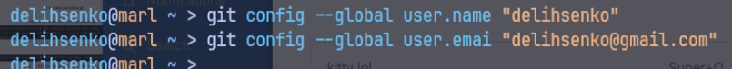

Рисунок 1: Указываем имя пользователя и email для репозитория

Включаем кодировку utf-8 для вывода сообщений Git (рис.
<a href="#fig-fig2" class="quarto-xref">2</a>):

Рисунок 2: Включаем кодировку utf-8 для вывода сообщений Git

Называем начальную ветку master, а также настраиваем параметры autocrlf
и safecrlf (рис. <a href="#fig-fig3" class="quarto-xref">3</a>):

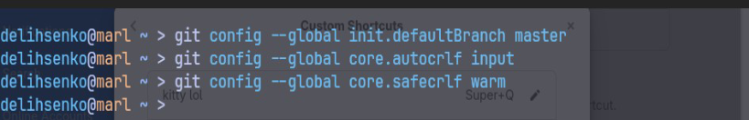

Рисунок 3: Настройка начальной ветки, autocrlf и safecrlf

## Создание SSH-ключа

Создаем пару SSH-ключей (рис.
<a href="#fig-fig4" class="quarto-xref">4</a>):

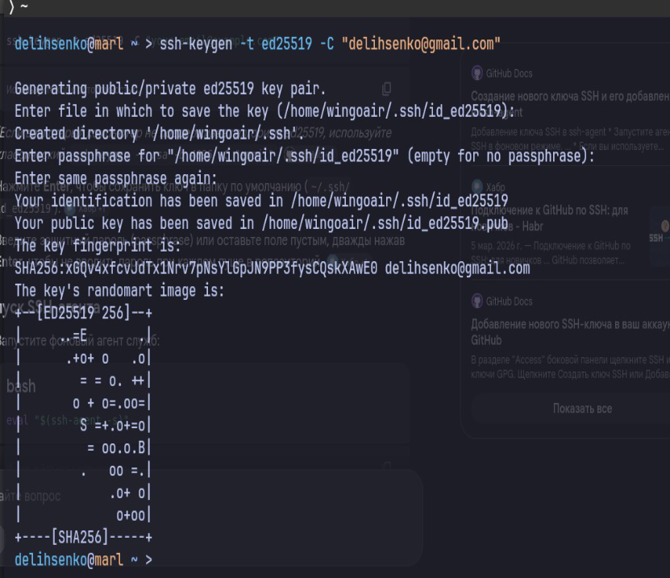

Рисунок 4: Создаем пару SSH-ключей

Копируем ключ из локального терминала в буфер обмена и входим в свой
аккаунт на сайте GitHub (рис.
<a href="#fig-fig5" class="quarto-xref">5</a>):

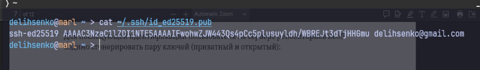

Рисунок 5: Копируем ключ и входим в аккаунт на GitHub

Убеждаемся, что ключ добавлен (рис.
<a href="#fig-fig6" class="quarto-xref">6</a>):

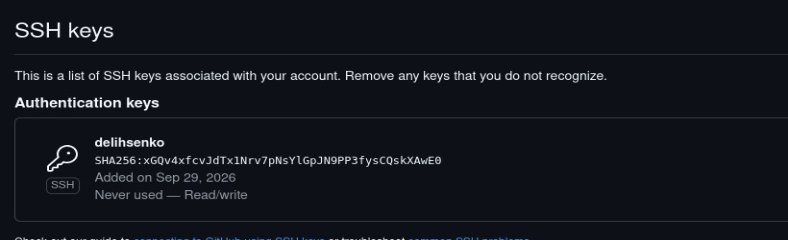

Рисунок 6: Ключ добавлен

## Создание рабочего пространства и репозитория курса на основе шаблона

Создаем папку для дисциплины «Архитектура компьютера» (рис.
<a href="#fig-fig7" class="quarto-xref">7</a>):

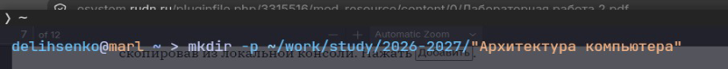

Рисунок 7: Создаем папку для дисциплины «Архитектура компьютера»

## Создание репозитория курса

Переходим на страницу репозитория с шаблоном. Создаем репозиторий на
основе шаблона и задаем ему имя «study_2026–2027_arh-pc» (рис.
<a href="#fig-fig8" class="quarto-xref">8</a>):

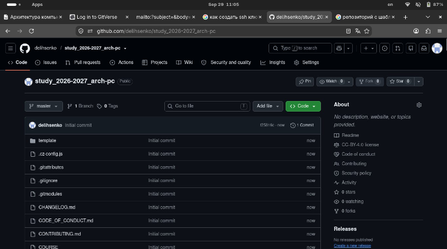

Рисунок 8: Создаем репозиторий на основе шаблона

Запускаем терминал и заходим в каталог курса (рис.
<a href="#fig-fig9" class="quarto-xref">9</a>):

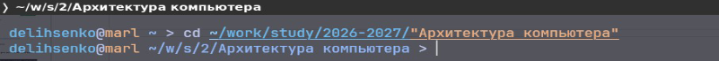

Рисунок 9: Запускаем терминал и заходим в каталог курса

Выполняем клонирование созданного репозитория (рис.
<a href="#fig-fig10" class="quarto-xref">10</a>):

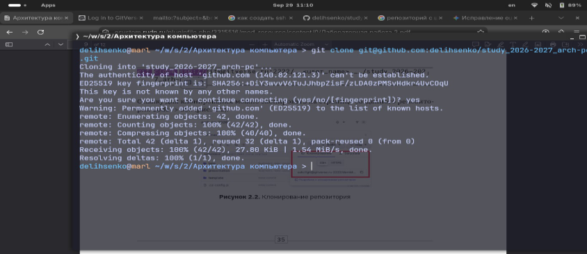

Рисунок 10: Клонирование созданного репозитория

## Настройка каталога курса

Перемещаемся в папку курса (рис.
<a href="#fig-fig11" class="quarto-xref">11</a>):

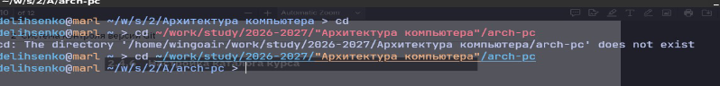

Рисунок 11: Перемещаемся в папку курса

Создаем нужные каталоги (рис.
<a href="#fig-fig12" class="quarto-xref">12</a>):

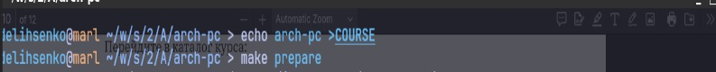

Рисунок 12: Создаем нужные каталоги

Добавляем файл под отслеживание и фиксируем изменения в репозитории
(рис. <a href="#fig-fig13" class="quarto-xref">13</a>):

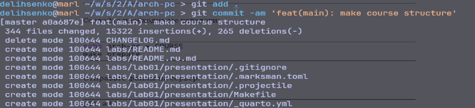

Рисунок 13: Добавляем файл под отслеживание и фиксируем изменения

Выгружаем данные в репозиторий (рис.
<a href="#fig-fig14" class="quarto-xref">14</a>):

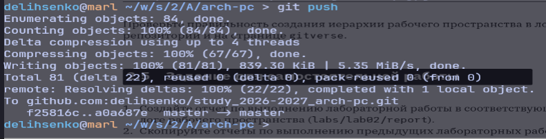

Рисунок 14: Выгружаем данные в репозиторий

Проверяем, что структура рабочего пространства в локальном репозитории
создана корректно (рис.
<a href="#fig-fig15" class="quarto-xref">15</a>):

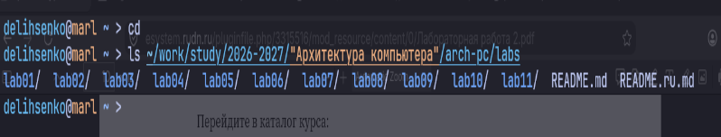

Рисунок 15: Структура рабочего пространства в локальном репозитории

Проверяем, что структура рабочего пространства корректно отобразилась на
странице GitHub (рис. <a href="#fig-fig16" class="quarto-xref">16</a>):

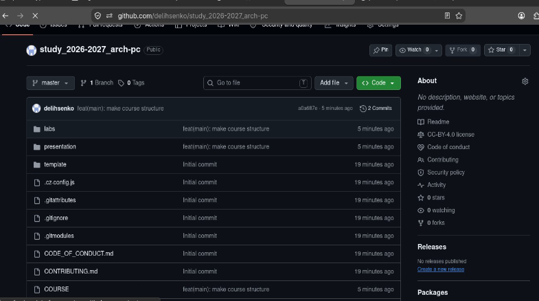

Рисунок 16: Структура рабочего пространства на странице GitHub

# Задание для самостоятельной работы

Переносим отчет по лабораторной работе № 1 в каталог `labs/lab01/report`
(рис. <a href="#fig-fig17" class="quarto-xref">17</a>):

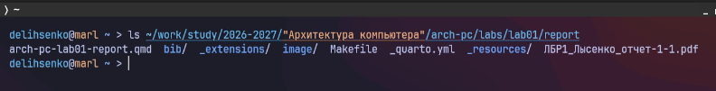

Рисунок 17: Переносим отчет по лабораторной работе № 1 в каталог
labs/lab01/report

Готовим отчет по лабораторной работе в каталоге `labs/lab02/report`
(рис. <a href="#fig-fig18" class="quarto-xref">18</a>):

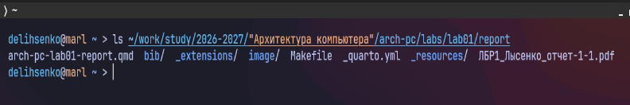

Рисунок 18: Готовим отчет по лабораторной работе в каталоге
labs/lab02/report

Выкладываем файлы на GitHub (рис.
<a href="#fig-fig19" class="quarto-xref">19</a>,
<a href="#fig-fig20" class="quarto-xref">20</a>):

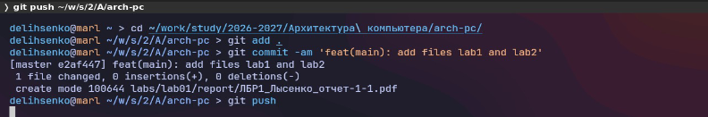

Рисунок 19: Выкладываем файл первой лабораторной работы на GitHub

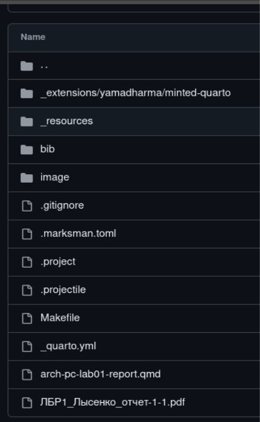

Рисунок 20: Выкладываем файлы на GitHub

Убеждаемся, что файлы лабораторных работ появились на GitHub (рис.
<a href="#fig-fig21" class="quarto-xref">21</a>):

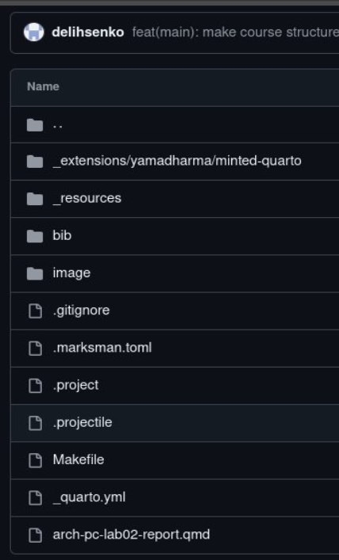

Рисунок 21: Файлы лабораторных работ на GitHub

# Заключение

В ходе лабораторной работы я изучил идеологию и применение средств
контроля версий, приобрёл практические навыки по работе с системой
контроля версий Git.
