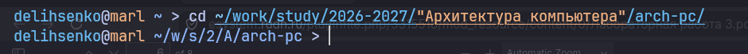
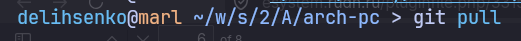
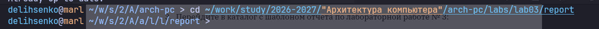
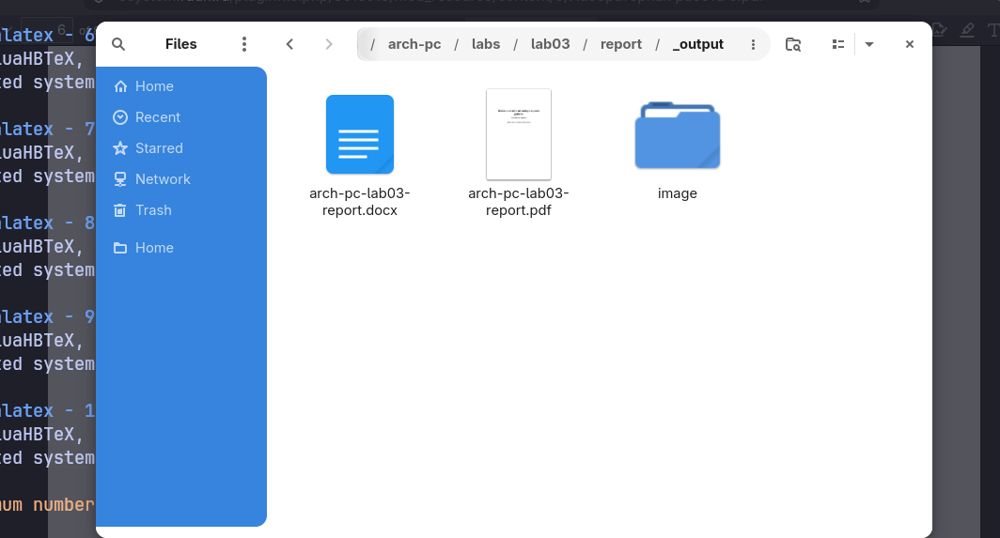
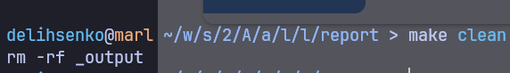
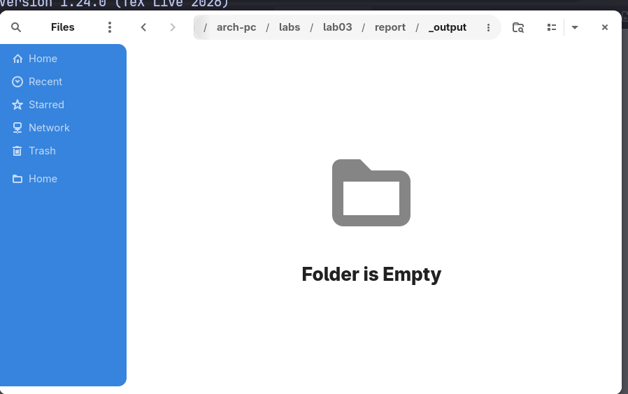
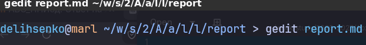
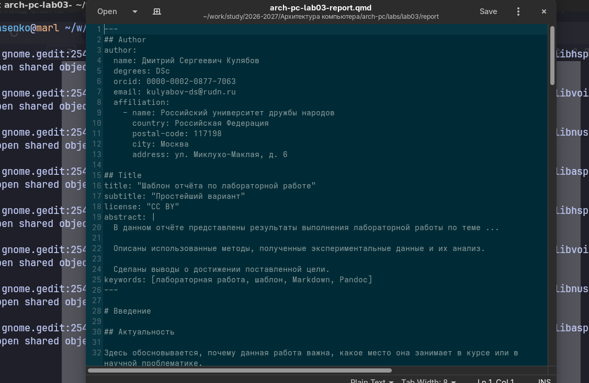

---
## Author
author:
  name: Лысенко Даниил Эдуардович
  degrees: DSc
  orcid: 0000-0002-0877-7063
  email: 1132260105@rudn.ru
  affiliation:
    - name: Российский университет дружбы народов
      country: Российская Федерация
      postal-code: 117198
      city: Москва
      address: ул. Миклухо-Маклая, д. 6

## Title
title: "Шаблон отчёта по лабораторной работе"
subtitle: "Простейший вариант"
license: "CC BY"
abstract: |
  В данном отчёте представлены результаты выполнения лабораторной работы по теме "Язык разметки Markdown"

  Сделаны выводы о достижении поставленной цели.
keywords: [лабораторная работа, шаблон, Markdown, Pandoc]
---

# Цель работы

Целью работы является освоение процедуры оформления отчетов с помощью
легковесного языка разметки Markdown.

# Выполнение лабораторной работы
1. Откройте терминал.
2. Перейдите в каталог курса, сформированный при выполнении лабораторной работы № 2 (рис. [-@fig-fig1]):

{#fig-fig1 width=70%}

Обновите локальный репозиторий, скачав изменения из удаленного репозитория с помощью команды (рис. [-@fig-fig2])

{#fig-fig2 width=70%}

3. Перейдите в каталог с шаблоном отчета по лабораторной работе №3 (рис. [-@fig-fig3]):

{#fig-fig3 width=50%}

4. Проведите компиляцию шаблона с использованием Makefile. Для этого введите команду(рис. [-@fig-fig4])

{#fig-fig4 width=50%}

При успешной компиляции должны сгенерироваться файлы report.pdf и
report.docx. Откройте и проверьте корректность полученных файлов.(рис. [-@fig-fig5], [-@fig-fig6], [-@fig-fig7])

{#fig-fig5 width=50%}

{#fig-fig6 width=50%}

{#fig-fig7 width=50%}

5. Удалите полученный файлы с использованием Makefile. Для этого введите команду(рис. [-@fig-fig8])

{#fig-fig8 width=50%}

Проверьте, что после этой команды файлы report.pdf и report.docx были удалены.(рис. [-@fig-fig9])

{#fig-fig9 width=50%}

6. Откройте файл report.md c помощью любого текстового редактора, например gedit(рис. [-@fig-fig10], [-@fig-fig11])

{#fig-fig10 width=50%}

{#fig-fig11 width=50%}

Внимательно изучите структуру этого файла.

7. Заполните отчет и скомпилируйте отчет с использованием Makefile. Проверьте корректность полученных файлов. (Обратите внимание, для корректного отображения скриншотов они должны быть размещены в каталоге image.)

8. Загрузите файлы на Github(рис. [-@fig-fig12]).

{#fig-fig12 width=50%}

# Задание для самостоятельной работы
В соответствующем каталоге сделайте отчёт по лабораторной работе № 2 в
формате Markdown. В качестве отчёта необходимо предоставить отчёты в трех
форматах: pdf, docx и md(рис. [-@fig-fig13]).

{#fig-fig13 width=50%}

Загрузите файлы на gitverse(рис. [-@fig-fig14]).

{#fig-fig14 width=50%}

# Заключение

В ходе данной лабораторной работы я научился оформлять отчеты лабораторных работ с помощью легкословесного языка разметки Markdown. Данный навык поможет мне в дальнейшем корректно оформлять отчеты для лабораторных работ, докладов, т.д.
