---
## Author
author:
  name: Лысенко Даниил Эдуардович
  group: НПИбд-01-26
  affiliation:
    - name: Российский университет дружбы народов
      country: Российская Федерация
      city: Москва

## Title
title: "Отчёт по лабораторной работе №4"
subtitle: "Создание и процесс обработки программ на языке ассемблера NASM"
license: "CC BY"
abstract: |
  В данном отчёте представлены результаты выполнения лабораторной работы №4.

  Рассмотрены практические этапы создания, трансляции, компоновки и запуска программ на языке ассемблера NASM для 32-битной архитектуры: от программы «Hello world!» до расширенного синтаксиса командной строки `nasm` и работы компоновщика `ld`. В рамках самостоятельного задания создана модифицированная программа, выводящая в стандартный поток фамилию и имя автора.

  Файлы лабораторной работы помещены в локальный репозиторий и отправлены на удалённые хостинги GitVerse и GitHub.
keywords: [лабораторная работа, NASM, ассемблер, линкер, ld, Arch Linux, GitVerse, GitHub]
---

# Цель работы

Освоение процедуры компиляции и сборки программ, написанных на ассемблере NASM.

# Задание

1. Создать рабочий каталог и программу `hello.asm`, оттранслировать и скомпоновать её, запустить исполняемый файл.
2. Изучить расширенный синтаксис командной строки `nasm` и опции компоновщика `ld`.
3. Самостоятельно создать копию `lab4.asm`, изменить программу так, чтобы она выводила фамилию и имя студента, оттранслировать, скомпоновать и запустить её.
4. Скопировать `hello.asm` и `lab4.asm` в локальный репозиторий курса и загрузить на GitVerse и GitHub.

## Схема выполнения работы

На рис. -@fig-flowchart представлена общая последовательность действий при выполнении лабораторной работы.

::: {#fig-flowchart}

```{mermaid}
%%| fig-width: 100%
graph TD
    A@{ shape: circle, label: "Начало" } --> B[Создание каталога и hello.asm]
    B --> C[Трансляция nasm -f elf]
    C --> D[Компоновка ld -m elf_i386]
    D --> E[Запуск ./hello]
    E --> F[Копия lab4.asm и правка строки]
    F --> G[Трансляция, компоновка, запуск lab4]
    G --> H[Копирование в репозиторий]
    H --> I[Отправка на GitVerse и GitHub]
    I --> J@{ shape: dbl-circ, label: "Конец" }
```

Блок-схема выполнения лабораторной работы

:::

# Теоретическое введение

Процесс создания программы на языке ассемблера состоит из четырёх шагов: набор текста программы в редакторе (файл типа `asm`), трансляция в объектный файл (тип `o`, при необходимости также файл листинга `lst`), компоновка объектного файла в исполняемый и запуск программы.

Для вывода строки на экран и завершения работы в 32-битных программах Linux используются прерывания ядра `int 80h`. Параметры передаются через регистры общего назначения. Краткое описание задействованных системных вызовов приведено в табл. -@tbl-syscalls.

| Имя вызова  | Номер (EAX) | Описание и регистры параметров                                                              |
|-------------|-------------|---------------------------------------------------------------------------------------------|
| `sys_exit`  | `1`         | Завершение программы. `EBX` содержит код возврата (0 --- успешное завершение).               |
| `sys_write` | `4`         | Запись в файл. `EBX` --- дескриптор (1 для stdout), `ECX` --- адрес строки, `EDX` --- длина. |

: Системные вызовы ядра Linux (i386) {#tbl-syscalls}

# Выполнение лабораторной работы

Работа выполнялась на персональном компьютере под управлением операционной системы Arch Linux. Использовались транслятор `nasm`, компоновщик `ld` из пакета `binutils`, текстовый редактор и система контроля версий `git`.

## Программа Hello world!

Был создан каталог для работы с программами на языке ассемблера NASM, выполнен переход в него и создан текстовый файл `hello.asm` (рис. -@fig-mkdir):

```bash
mkdir -p ~/work/arch-pc/lab04
cd ~/work/arch-pc/lab04
touch hello.asm
```

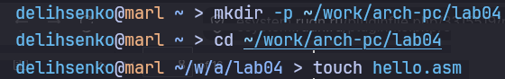{#fig-mkdir width=80%}

Файл `hello.asm` был открыт в текстовом редакторе, в него введён текст программы из методического указания (рис. -@fig-hello-edit). Программа помещает в секцию данных строку `Hello world!` с символом перевода строки, вычисляет её длину директивой `EQU $-hello`, затем выполняет системный вызов `sys_write` и завершает работу вызовом `sys_exit`. Полный текст приведён в приложении А.

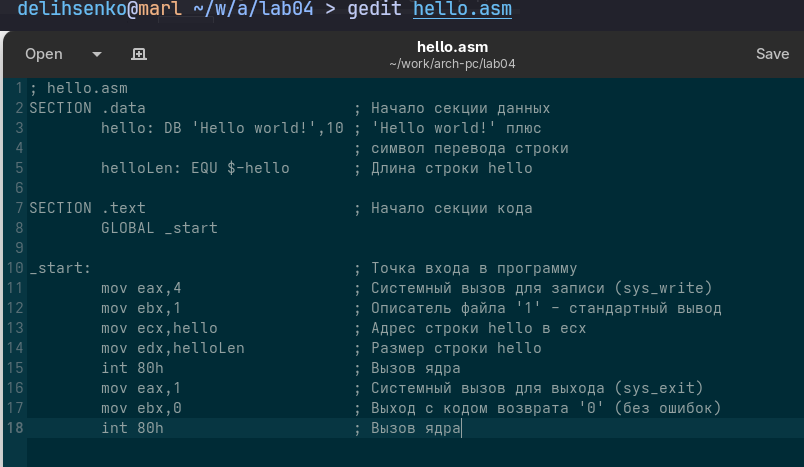{#fig-hello-edit width=80%}

## Транслятор NASM

Для превращения текста программы в объектный код была выполнена команда (рис. -@fig-nasm-hello):

```bash
nasm -f elf hello.asm
```

Ключ `-f` задаёт формат выходного файла; для 32-битных систем указывается `elf` (для 64-битных --- `elf64`). Командой `ls` проверено, что в текущем каталоге появился объектный файл. Он получает имя из имени входного файла и расширения по умолчанию, то есть называется **`hello.o`**.

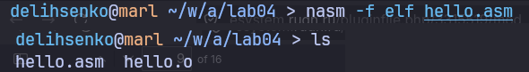{#fig-nasm-hello width=80%}

## Расширенный синтаксис командной строки NASM

Полный вариант командной строки имеет вид:

```bash
nasm [-@ косвенный_файл_настроек] [-o объектный_файл] [-f формат_объектного_файла] [-l листинг] [параметры...] [--] исходный_файл
```

Была выполнена команда (рис. -@fig-nasm-ext):

```bash
nasm -o obj.o -f elf -g -l list.lst hello.asm
```

Она компилирует `hello.asm` в объектный файл `obj.o` (опция `-o` задаёт имя), формат выходного файла --- `elf`, в файл включены отладочные символы (опция `-g`), а также создан файл листинга `list.lst` (опция `-l`). Командой `ls` проверено, что файлы `obj.o` и `list.lst` созданы.

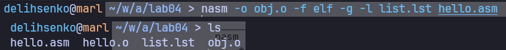{#fig-nasm-ext width=80%}

## Компоновщик LD

Чтобы получить исполняемую программу, объектный файл был передан компоновщику (рис. -@fig-ld-hello):

```bash
ld -m elf_i386 hello.o -o hello
```

Ключ `-m elf_i386` задаёт эмуляцию 32-битной архитектуры, ключ `-o` --- имя создаваемого исполняемого файла. Командой `ls` проверено, что исполняемый файл `hello` создан.

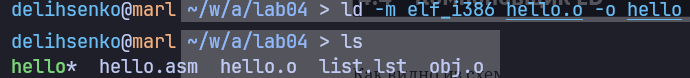{#fig-ld-hello width=80%}

Затем была выполнена команда (рис. -@fig-ld-main):

```bash
ld -m elf_i386 obj.o -o main
```

Исполняемый файл в этом случае будет иметь имя **`main`**, поскольку оно указано после ключа `-o`. Он собран из объектного файла **`obj.o`**. Таким образом, имя исполняемого файла не зависит от имени объектного файла и задаётся пользователем. Командой `ls -l` проверено, что файлы `main` и `hello` созданы и имеют права на исполнение.

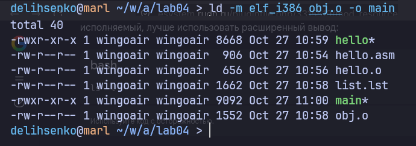{#fig-ld-main width=80%}

## Запуск исполняемого файла

Исполняемый файл, находящийся в текущем каталоге, был запущен командой `./hello` (рис. -@fig-run-hello). На экран выведено сообщение `Hello world!`.

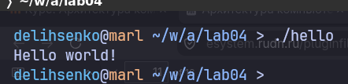{#fig-run-hello width=80%}

## Самостоятельная работа

**1.** В каталоге `~/work/arch-pc/lab04` с помощью команды `cp` создана копия файла `hello.asm` с именем `lab4.asm` (рис. -@fig-cp):

```bash
cp hello.asm lab4.asm
```

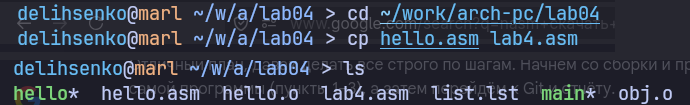{#fig-cp width=80%}

**2.** Файл `lab4.asm` открыт в текстовом редакторе. В секции данных строка `Hello world!` заменена на фамилию и имя автора --- `Лысенко Даниил`. Символ перевода строки (`10`) и директива вычисления длины `$-hello` оставлены без изменений (рис. -@fig-edit).

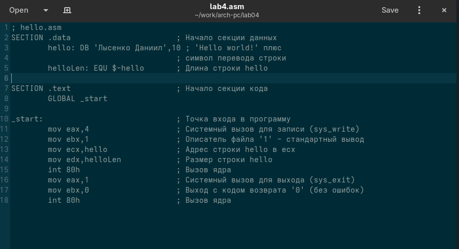{#fig-edit width=80%}

**3.** Изменённая программа была оттранслирована в объектный файл, скомпонована и запущена (рис. -@fig-compile, рис. -@fig-run-lab4):

```bash
nasm -f elf32 lab4.asm -o lab4.o
ld -m elf_i386 lab4.o -o lab4
./lab4
```

Результат сборки проверен командой `ls -l`: в каталоге появились объектный файл `lab4.o` и исполняемый файл `lab4` с правами на исполнение.

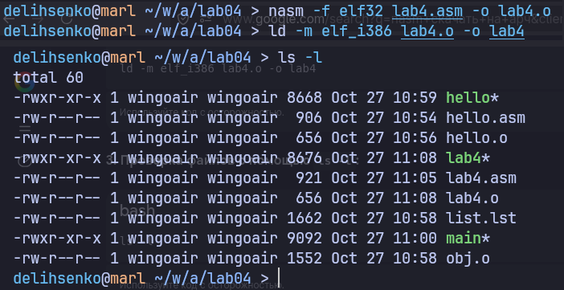{#fig-compile width=80%}

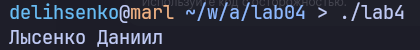{#fig-run-lab4 width=80%}

Программа успешно выполнила системный вызов `sys_write` и вывела на экран фамилию и имя автора. Длина строки вычисляется ассемблером автоматически, поэтому при замене текста (в том числе кириллического, где в UTF-8 на букву приходится 2 байта) править значение длины вручную не требуется.

**4.** Файлы `hello.asm` и `lab4.asm` были скопированы в каталог лабораторной работы локального репозитория курса (рис. -@fig-repo-cp):

```bash
cp hello.asm lab4.asm ~/work/study/2026-2027/"Архитектура компьютера"/arch-pc/labs/lab04/
```

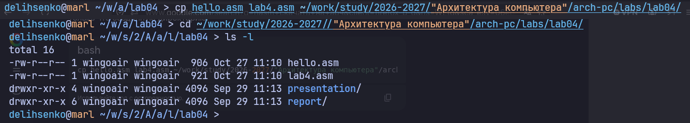{#fig-repo-cp width=80%}

Изменения добавлены в индекс и зафиксированы коммитом (рис. -@fig-commit):

```bash
git add hello.asm lab4.asm
git commit -m "Lab 04: Added hello.asm and completed lab4.asm independent work"
```

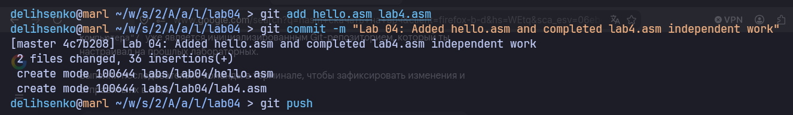{#fig-commit width=80%}

Затем изменения отправлены на GitHub командой `git push` (рис. -@fig-push-gh); наличие файлов в репозитории подтверждено в веб-интерфейсе (рис. -@fig-web-gh):

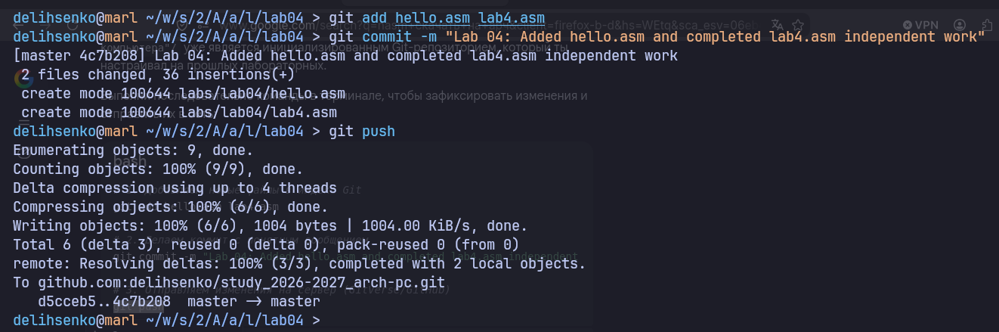{#fig-push-gh width=80%}

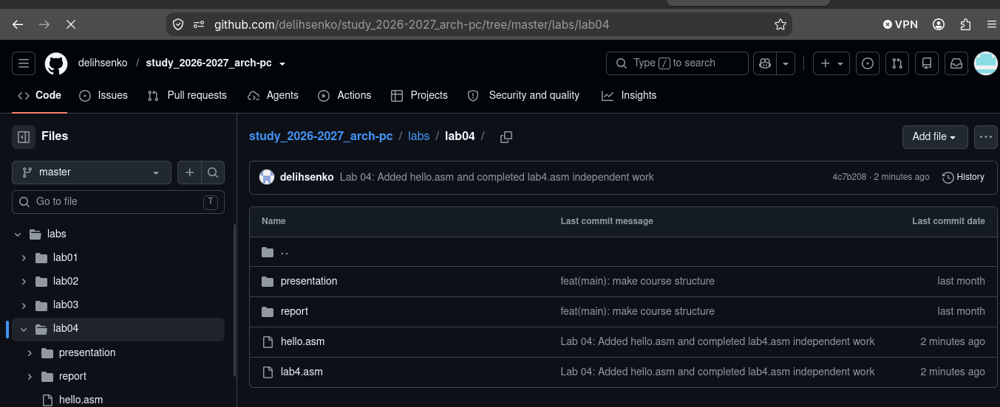{#fig-web-gh width=80%}

Для отправки на GitVerse использован отдельный удалённый репозиторий `gitverse` (рис. -@fig-push-gv), после чего файлы также появились в веб-интерфейсе платформы (рис. -@fig-web-gv):

```bash
git push gitverse master
```

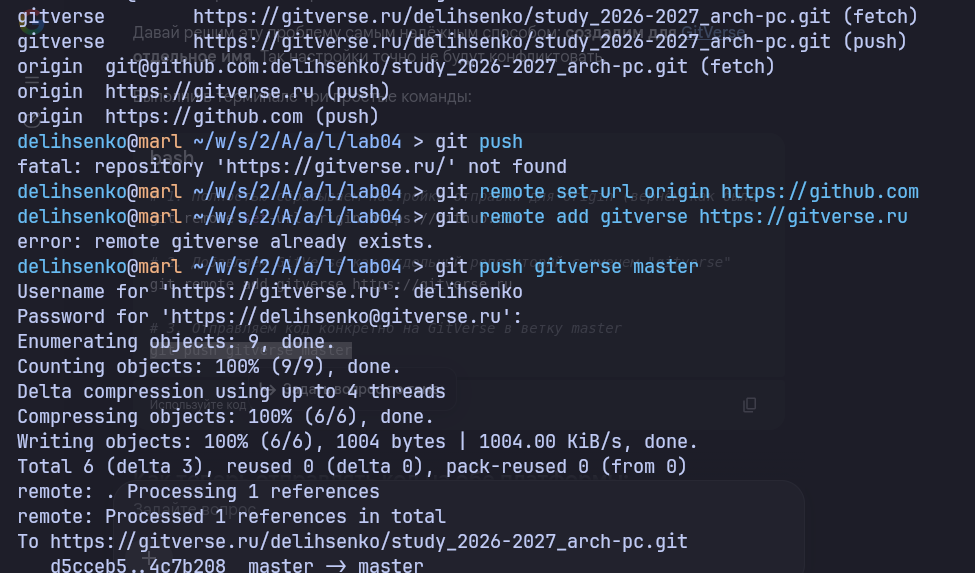{#fig-push-gv width=80%}

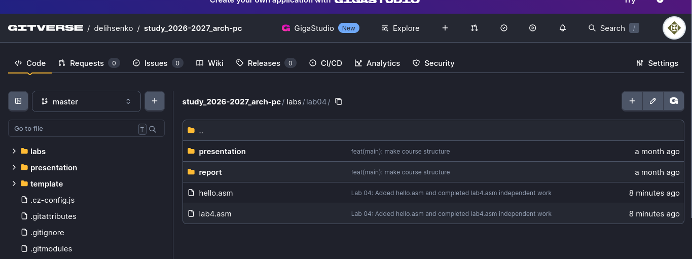{#fig-web-gv width=80%}

# Выводы

В ходе выполнения лабораторной работы освоена процедура создания, трансляции и компоновки программ на языке ассемблера NASM: изучены назначение ключей `-f`, `-o`, `-g`, `-l` транслятора `nasm` и ключей `-m`, `-o` компоновщика `ld`, получены объектный файл, файл листинга и исполняемые файлы. Самостоятельно создана и запущена программа `lab4`, выводящая фамилию и имя автора, а её исходный код загружен в удалённые репозитории GitVerse и GitHub.

\appendix

# Приложение А. Листинги программ {.appendix}

## hello.asm

```nasm
; hello.asm
SECTION .data                       ; Начало секции данных
    hello: DB 'Hello world!',10     ; 'Hello world!' плюс символ перевода строки
    helloLen: EQU $-hello           ; Длина строки hello

SECTION .text                       ; Начало секции кода
    GLOBAL _start

_start:                             ; Точка входа в программу
    mov eax,4                       ; Системный вызов для записи (sys_write)
    mov ebx,1                       ; Описатель файла '1' - стандартный вывод
    mov ecx,hello                   ; Адрес строки hello в ecx
    mov edx,helloLen                ; Размер строки hello
    int 80h                         ; Вызов ядра

    mov eax,1                       ; Системный вызов для выхода (sys_exit)
    mov ebx,0                       ; Выход с кодом возврата '0' (без ошибок)
    int 80h                         ; Вызов ядра
```

## lab4.asm

```nasm
; lab4.asm
SECTION .data
    hello: DB 'Лысенко Даниил',10   ; Фамилия и имя плюс символ перевода строки
    helloLen: EQU $-hello           ; Автоматический расчёт длины строки

SECTION .text
    GLOBAL _start

_start:
    mov eax,4                       ; Системный вызов для записи (sys_write)
    mov ebx,1                       ; Описатель файла '1' - стандартный вывод
    mov ecx,hello                   ; Адрес строки hello в ecx
    mov edx,helloLen                ; Размер строки hello в edx
    int 80h                         ; Вызов ядра

    mov eax,1                       ; Системный вызов для выхода (sys_exit)
    mov ebx,0                       ; Выход с кодом возврата '0' (без ошибок)
    int 80h                         ; Вызов ядра
```
