# Отчёт по лабораторной работе №5
Лысенко Даниил Эдуардович

- [<span class="toc-section-number">1</span> Введение](#введение)
  - [<span class="toc-section-number">1.1</span> Цель
    работы](#цель-работы)
  - [<span class="toc-section-number">1.2</span> Задачи](#задачи)
- [<span class="toc-section-number">2</span> Теоретическая
  часть](#теоретическая-часть)
  - [<span class="toc-section-number">2.1</span> Midnight
    Commander](#midnight-commander)
  - [<span class="toc-section-number">2.2</span> Структура программы на
    NASM](#структура-программы-на-nasm)
  - [<span class="toc-section-number">2.3</span> Инструкции mov и
    int](#инструкции-mov-и-int)
- [<span class="toc-section-number">3</span> Материалы и
  методы](#материалы-и-методы)
- [<span class="toc-section-number">4</span> Выполнение лабораторной
  работы](#выполнение-лабораторной-работы)
  - [<span class="toc-section-number">4.1</span> Работа в Midnight
    Commander](#работа-в-midnight-commander)
  - [<span class="toc-section-number">4.2</span> Трансляция, компоновка
    и запуск](#трансляция-компоновка-и-запуск)
  - [<span class="toc-section-number">4.3</span> Подключение внешнего
    файла in_out.asm](#подключение-внешнего-файла-in_outasm)
- [<span class="toc-section-number">5</span> Выполнение самостоятельной
  работы](#выполнение-самостоятельной-работы)
  - [<span class="toc-section-number">5.1</span> Программа без
    in_out.asm (lab5-3)](#программа-без-in_outasm-lab5-3)
  - [<span class="toc-section-number">5.2</span> Программа с in_out.asm
    (lab5-4)](#программа-с-in_outasm-lab5-4)
- [<span class="toc-section-number">6</span> Результаты](#результаты)
- [<span class="toc-section-number">7</span> Обсуждение
  результатов](#обсуждение-результатов)
- [<span class="toc-section-number">8</span> Заключение](#заключение)
- [<span class="toc-section-number">9</span> Листинги
  программ](#листинги-программ)
  - [<span class="toc-section-number">9.1</span> Листинг
    lab5-1.asm](#листинг-lab5-1asm)
  - [<span class="toc-section-number">9.2</span> Листинг
    lab5-2.asm](#листинг-lab5-2asm)
  - [<span class="toc-section-number">9.3</span> Листинг
    lab5-3.asm](#листинг-lab5-3asm)
  - [<span class="toc-section-number">9.4</span> Листинг
    lab5-4.asm](#листинг-lab5-4asm)

# Введение

## Цель работы

Приобретение практических навыков работы в Midnight Commander. Освоение
инструкций языка ассемблера `mov` и `int`.

## Задачи

- освоить основные операции в файловом менеджере `mc`: навигацию,
  создание каталогов и файлов, копирование, перемещение, просмотр и
  редактирование;
- изучить структуру программы на языке ассемблера NASM (секции `.data`,
  `.bss`, `.text`);
- написать, оттранслировать, скомпоновать и запустить программу, которая
  выводит приглашение и читает строку с клавиатуры, используя системные
  вызовы Linux;
- переписать программу с использованием подпрограмм из внешнего файла
  `in_out.asm` и сравнить `sprint` и `sprintLF`;
- выполнить задания для самостоятельной работы.

# Теоретическая часть

## Midnight Commander

Midnight Commander (`mc`) — файловый менеджер с двумя панелями, который
позволяет просматривать структуру каталогов и выполнять основные
операции с файлами. Запускается командой `mc`. Основные функциональные
клавиши, использованные в работе, приведены в табл.
<a href="#tbl-keys" class="quarto-xref">1</a>.

<div id="tbl-keys">

Таблица 1: Функциональные клавиши Midnight Commander

| Клавиша | Действие                                     |
|---------|----------------------------------------------|
| `F3`    | просмотр файла                               |
| `F4`    | редактирование файла во встроенном редакторе |
| `F5`    | копирование файла в каталог второй панели    |
| `F6`    | перенос или переименование файла             |
| `F7`    | создание каталога                            |
| `F10`   | выход из программы                           |
| `Tab`   | переключение между панелями                  |

</div>

## Структура программы на NASM

Программа на NASM состоит из трёх секций: `SECTION .data` (данные с
начальными значениями), `SECTION .bss` (неинициализированные данные, под
которые только резервируется память) и `SECTION .text` (код программы,
точка входа `_start`). Для инициализированных данных применяются
директивы `DB`, `DW`, `DD`, `DQ`, `DT` (1, 2, 4, 8 и 10 байт), для
резервирования памяти в `.bss` — `resb`, `resw`, `resd`.

## Инструкции mov и int

Инструкция `mov dst, src` копирует данные из источника в приёмник.
Операндами могут быть регистры, ячейки памяти и непосредственные
значения; размеры операндов должны совпадать, а переслать значение из
одной ячейки памяти в другую одной инструкцией `mov` нельзя.

Инструкция `int n` вызывает прерывание с номером `n`. В Linux системные
вызовы выполняются через `int 80h`: номер вызова помещается в `eax`,
параметры — в `ebx`, `ecx`, `edx`, результат возвращается в `eax`.
Использованы вызовы `sys_write` (4), `sys_read` (3) и `sys_exit` (1).

# Материалы и методы

Работа выполнялась в терминале ОС Linux. Использованы файловый менеджер
Midnight Commander и его встроенный редактор `mcedit`, ассемблер NASM,
компоновщик `ld` (режим `elf_i386`) и файл подпрограмм `in_out.asm` из
материалов курса. Все файлы лабораторной работы находятся в каталоге
`~/work/arch-pc/lab05`.

# Выполнение лабораторной работы

## Работа в Midnight Commander

Midnight Commander запущен командой `mc` (рис.
<a href="#fig-1" class="quarto-xref">1</a>). С помощью стрелок и `Enter`
выполнен переход в каталог `~/work/arch-pc`, созданный в лабораторной
работе №4 (рис. <a href="#fig-2" class="quarto-xref">2</a>).

<div id="fig-1">

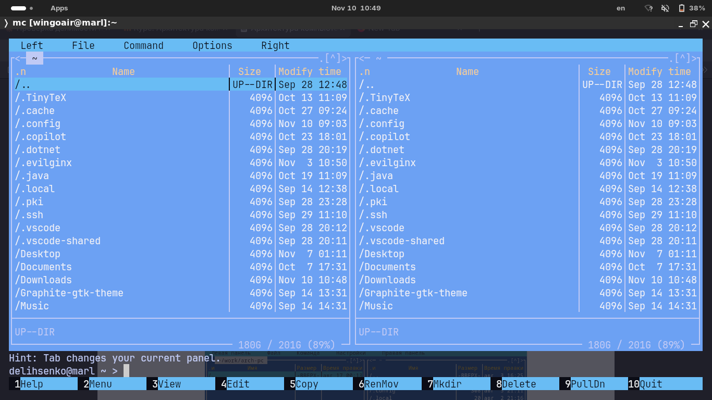

Рисунок 1: Запуск Midnight Commander в домашнем каталоге

</div>

<div id="fig-2">

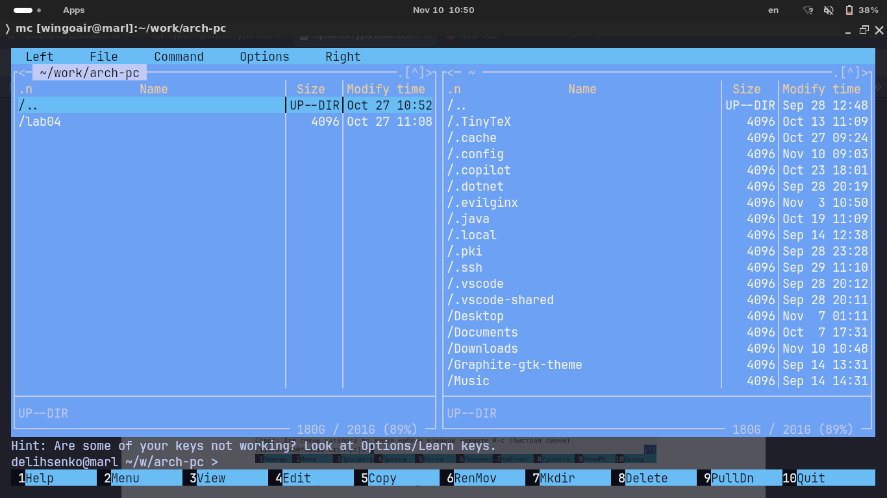

Рисунок 2: Переход в каталог ~/work/arch-pc

</div>

Клавишей `F7` создан каталог `lab05` (рис.
<a href="#fig-3" class="quarto-xref">3</a>), после чего выполнен переход
в него. Командой `touch lab5-1.asm` в строке ввода создан файл для
программы (рис. <a href="#fig-4" class="quarto-xref">4</a>, рис.
<a href="#fig-5" class="quarto-xref">5</a>).

<div id="fig-3">

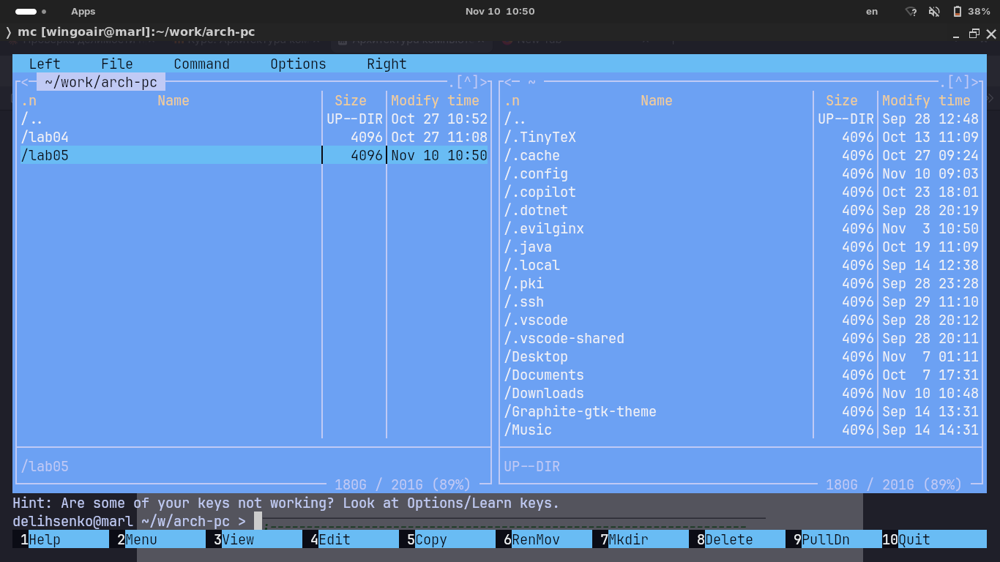

Рисунок 3: Создание каталога lab05 клавишей F7

</div>

<div id="fig-4">


Рисунок 4: Создание файла lab5-1.asm командой touch

</div>

<div id="fig-5">

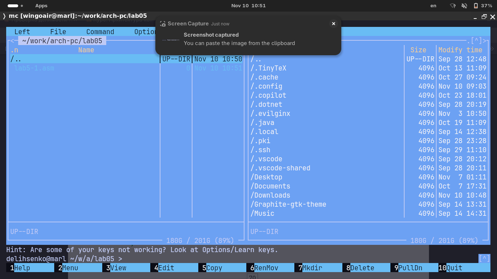

Рисунок 5: Файл lab5-1.asm в каталоге lab05

</div>

Файл `lab5-1.asm` открыт клавишей `F4` во встроенном редакторе `mcedit`,
введён текст программы из листинга 5.1 и сохранён клавишей `F2` (рис.
<a href="#fig-6" class="quarto-xref">6</a>). Клавишей `F3` проверено,
что файл содержит текст программы.

<div id="fig-6">

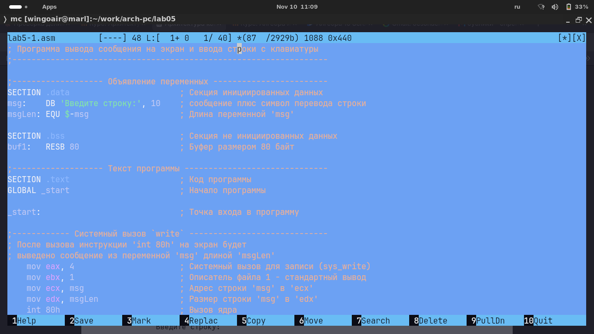

Рисунок 6: Текст программы lab5-1.asm во встроенном редакторе mcedit

</div>

## Трансляция, компоновка и запуск

Программа оттранслирована в объектный файл командой
`nasm -f elf lab5-1.asm`, затем скомпонована командой
`ld -m elf_i386 -o lab5-1 lab5-1.o` (рис.
<a href="#fig-7" class="quarto-xref">7</a>). После запуска `./lab5-1`
программа вывела приглашение «Введите строку:» и дождалась ввода; на
запрос введены ФИО (рис. <a href="#fig-8" class="quarto-xref">8</a>).

<div id="fig-7">

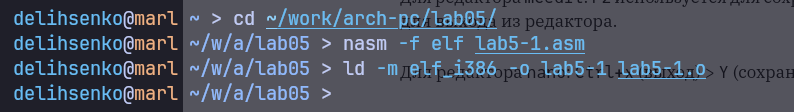

Рисунок 7: Трансляция и компоновка программы lab5-1

</div>

<div id="fig-8">

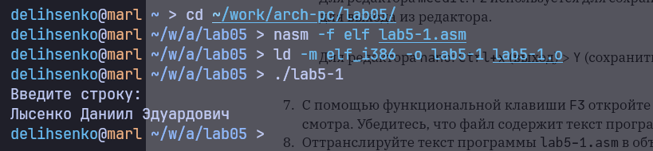

Рисунок 8: Запуск lab5-1 и ввод ФИО

</div>

## Подключение внешнего файла in_out.asm

Файл `in_out.asm` из каталога `~/Downloads` скопирован клавишей `F5` в
каталог `lab05`, то есть в тот же каталог, где лежит программа (рис.
<a href="#fig-9" class="quarto-xref">9</a>). Клавишей `F6` создан файл
`lab5-2.asm` на основе `lab5-1.asm` (рис.
<a href="#fig-10" class="quarto-xref">10</a>, рис.
<a href="#fig-11" class="quarto-xref">11</a>).

<div id="fig-9">

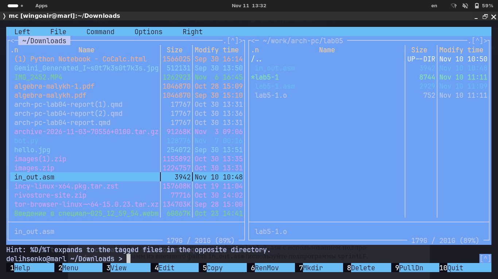

Рисунок 9: Копирование файла in_out.asm в каталог lab05 (F5)

</div>

<div id="fig-10">

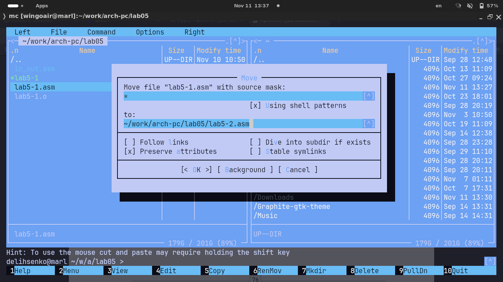

Рисунок 10: Создание файла lab5-2.asm на основе lab5-1.asm (F6)

</div>

<div id="fig-11">

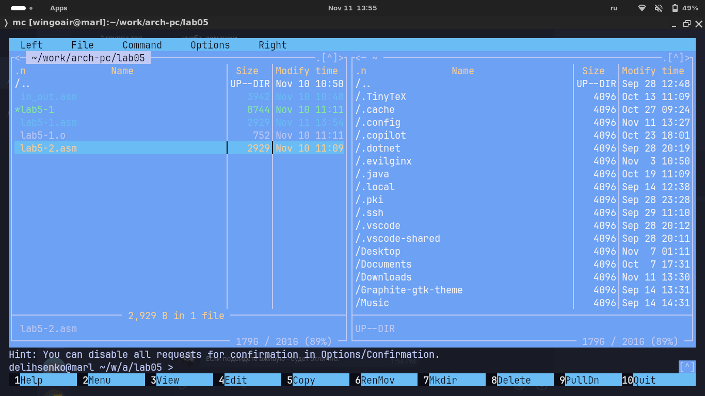

Рисунок 11: Содержимое каталога lab05 после создания lab5-2.asm

</div>

В `lab5-2.asm` текст программы исправлен в соответствии с листингом 5.2:
подключён `in_out.asm` директивой `%include`, вывод сообщения
выполняется подпрограммой `sprintLF`, ввод — подпрограммой `sread`,
завершение — `quit` (рис. <a href="#fig-12" class="quarto-xref">12</a>).
Исполняемый файл получен командами
`nasm -f elf32 lab5-2.asm -o lab5-2.o` и
`ld -m elf_i386 lab5-2.o -o lab5-2`; на запрос введена строка «привет»
(рис. <a href="#fig-13" class="quarto-xref">13</a>).

<div id="fig-12">

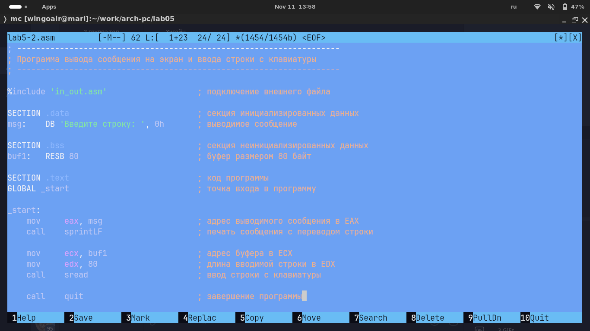

Рисунок 12: Текст программы lab5-2.asm с подключением in_out.asm

</div>

<div id="fig-13">

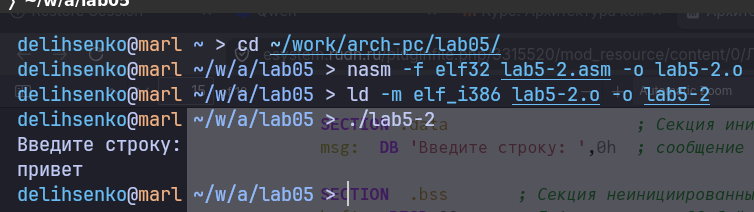

Рисунок 13: Запуск lab5-2 с подпрограммой sprintLF

</div>

Затем в `lab5-2.asm` подпрограмма `sprintLF` заменена на `sprint`,
программа пересобрана и запущена (рис.
<a href="#fig-14" class="quarto-xref">14</a>).

<div id="fig-14">

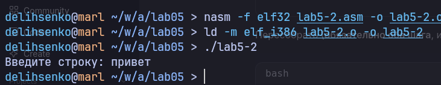

Рисунок 14: Запуск lab5-2 с подпрограммой sprint

</div>

**Разница между `sprint` и `sprintLF`.** `sprintLF` после сообщения
добавляет символ перевода строки, поэтому ввод начинается на новой
строке (рис. <a href="#fig-13" class="quarto-xref">13</a>). `sprint`
перевод строки не добавляет, и введённый текст оказывается в той же
строке, что и приглашение (рис.
<a href="#fig-14" class="quarto-xref">14</a>).

# Выполнение самостоятельной работы

## Программа без in_out.asm (lab5-3)

**Задание.** Создать копию `lab5-1.asm` и изменить программу (без
`in_out.asm`) так, чтобы она выводила приглашение «Введите строку: »,
читала строку с клавиатуры и выводила введённую строку на экран.
Получить исполняемый файл, проверить работу, на приглашение ввести свою
фамилию.

Копия создана клавишей `F5` под именем `lab5-3.asm` (рис.
<a href="#fig-15" class="quarto-xref">15</a>). После вызова `sys_read`
регистр `eax` содержит число прочитанных байт, поэтому он копируется в
`edx` и используется как длина строки при втором вызове `sys_write`
(рис. <a href="#fig-16" class="quarto-xref">16</a>). Программа собрана
командами `nasm -f elf32 lab5-3.asm -o lab5-3.o` и
`ld -m elf_i386 lab5-3.o -o lab5-3`; на приглашение введена фамилия,
программа вывела её на экран (рис.
<a href="#fig-17" class="quarto-xref">17</a>).

<div id="fig-15">

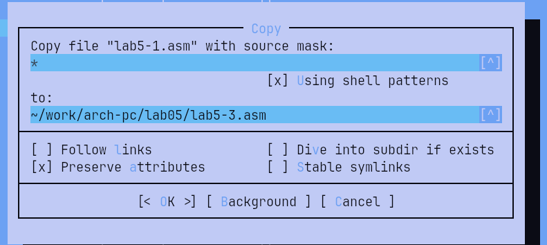

Рисунок 15: Копирование lab5-1.asm в lab5-3.asm

</div>

<div id="fig-16">

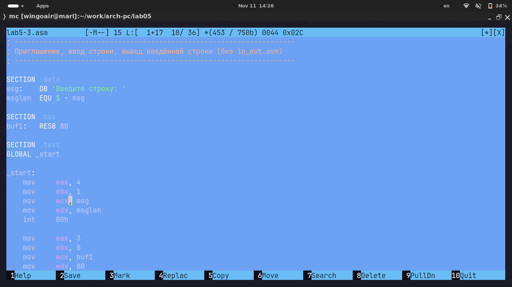

Рисунок 16: Текст программы lab5-3.asm (без in_out.asm)

</div>

<div id="fig-17">

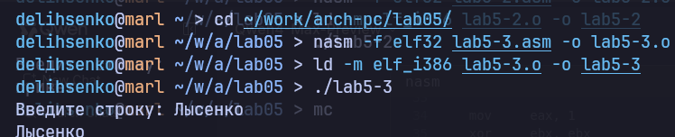

Рисунок 17: Запуск lab5-3: ввод и вывод строки

</div>

## Программа с in_out.asm (lab5-4)

**Задание.** Создать копию `lab5-2.asm` и исправить её с использованием
подпрограмм из `in_out.asm` так, чтобы она выводила приглашение, читала
строку и выводила введённую строку на экран. Создать исполняемый файл и
проверить его работу.

Копия создана клавишей `F5` под именем `lab5-4.asm` (рис.
<a href="#fig-18" class="quarto-xref">18</a>). После `sread` в `eax`
помещён адрес буфера `buf1`, и введённая строка выведена подпрограммой
`sprintLF` (рис. <a href="#fig-19" class="quarto-xref">19</a>).
Исполняемый файл получен командами
`nasm -f elf32 lab5-4.asm -o lab5-4.o` и
`ld -m elf_i386 lab5-4.o -o lab5-4`. Файл `in_out.asm` лежит в том же
каталоге, что и программа. На приглашение введена фамилия, программа
вывела введённую строку на экран (рис.
<a href="#fig-20" class="quarto-xref">20</a>).

<div id="fig-18">

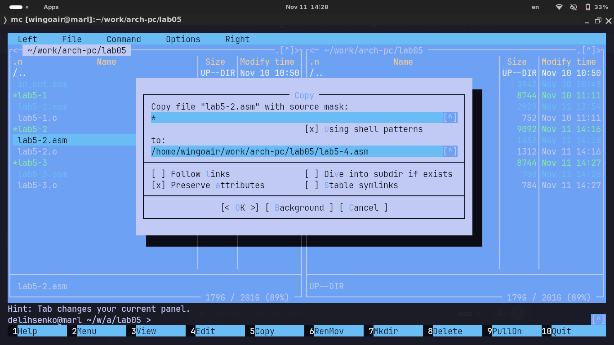

Рисунок 18: Копирование lab5-2.asm в lab5-4.asm

</div>

<div id="fig-19">

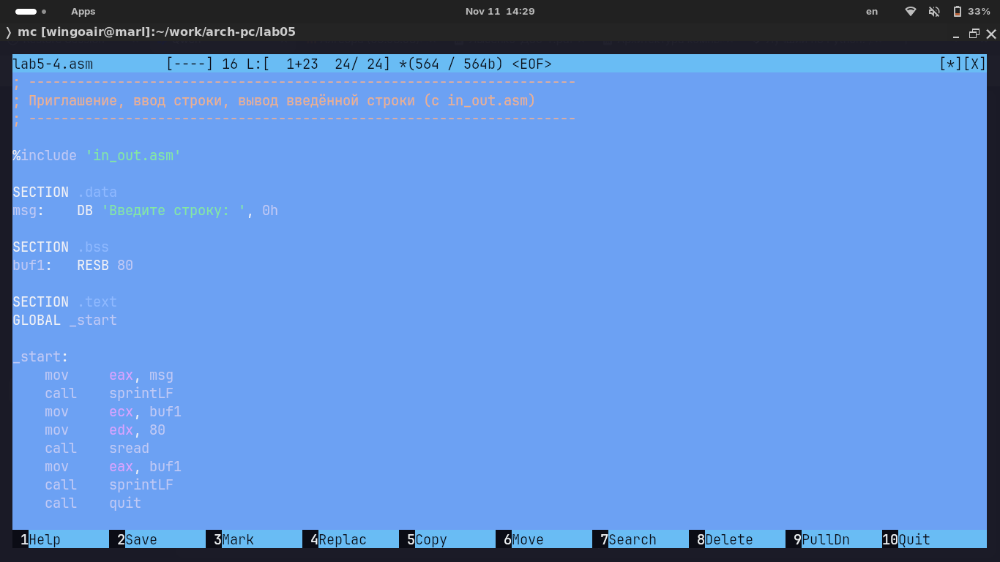

Рисунок 19: Текст программы lab5-4.asm (с in_out.asm)

</div>

<div id="fig-20">

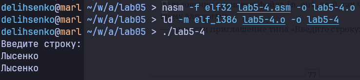

Рисунок 20: Запуск lab5-4: приглашение, ввод и вывод строки

</div>

Тексты программ приведены в приложении.

# Результаты

В каталоге `~/work/arch-pc/lab05` созданы и проверены четыре программы.

| Программа | Особенности | Результат |
|----|----|----|
| `lab5-1` | системные вызовы `write`, `read`, `exit`; строка читается, но не выводится | выведено приглашение, введены ФИО |
| `lab5-2` | подпрограммы `sprintLF`/`sprint`, `sread`, `quit` из `in_out.asm` | `sprintLF` — ввод на новой строке, `sprint` — на той же |
| `lab5-3` | самостоятельная работа, без `in_out.asm` | введённая фамилия выведена на экран |
| `lab5-4` | самостоятельная работа, с `in_out.asm` | приглашение, ввод и вывод введённой строки |

# Обсуждение результатов

Программа `lab5-1` напрямую использует три системных вызова через
`int 80h`, и для каждого приходится вручную заполнять `eax`, `ebx`,
`ecx`, `edx`. Подключение `in_out.asm` сводит ту же работу к вызовам
`sprint`, `sprintLF`, `sread` и `quit`: программа становится короче и
читается проще. Подпрограммы работают с нуль-терминированными строками
(в `msg` поэтому добавлен `0h`) и сами вычисляют длину строки, а в
`lab5-1` длина задаётся константой `msgLen`.

Разница между `sprint` и `sprintLF` подтверждена экспериментом (рис.
<a href="#fig-13" class="quarto-xref">13</a> и рис.
<a href="#fig-14" class="quarto-xref">14</a>). В `lab5-3` длина
выводимой строки берётся из результата `sys_read`, поэтому выводится
ровно то, что введено.

# Заключение

- Освоена работа в Midnight Commander: навигация, создание каталога
  (`F7`), файла (`touch`), просмотр (`F3`), редактирование (`F4`),
  копирование (`F5`) и переименование (`F6`).
- Изучена структура программы на NASM и назначение секций `.data`,
  `.bss`, `.text`.
- Освоены инструкции `mov` и `int 80h` и системные вызовы `sys_write`,
  `sys_read`, `sys_exit`.
- Написаны, собраны и запущены программы `lab5-1` … `lab5-4`; изучены
  подпрограммы `in_out.asm` и разница между `sprint` и `sprintLF`.

Цель работы достигнута.

# Листинги программ

## Листинг lab5-1.asm

``` nasm
; Программа вывода сообщения на экран и ввода строки с клавиатуры
;------------------------------------------------------------------

;------------------- Объявление переменных ------------------------
SECTION .data                       ; Секция инициированных данных
msg:    DB 'Введите строку:', 10    ; сообщение плюс символ перевода строки
msgLen: EQU $-msg                   ; Длина переменной 'msg'

SECTION .bss                        ; Секция не инициированных данных
buf1:   RESB 80                     ; Буфер размером 80 байт

;------------------- Текст программы ------------------------------
SECTION .text                       ; Код программы
GLOBAL _start                       ; Начало программы

_start:                             ; Точка входа в программу

;------------ Системный вызов `write` -----------------------------
; После вызова инструкции 'int 80h' на экран будет
; выведено сообщение из переменной 'msg' длиной 'msgLen'
    mov eax, 4                      ; Системный вызов для записи (sys_write)
    mov ebx, 1                      ; Описатель файла 1 - стандартный вывод
    mov ecx, msg                    ; Адрес строки 'msg' в 'ecx'
    mov edx, msgLen                 ; Размер строки 'msg' в 'edx'
    int 80h                         ; Вызов ядра

;------------ Системный вызов `read` ------------------------------
; После вызова инструкции 'int 80h' программа будет ожидать ввода
; строки, которая будет записана в переменную 'buf1' размером 80 байт
    mov eax, 3                      ; Системный вызов для чтения (sys_read)
    mov ebx, 0                      ; Дескриптор файла 0 - стандартный ввод
    mov ecx, buf1                   ; Адрес буфера под вводимую строку
    mov edx, 80                     ; Длина вводимой строки
    int 80h                         ; Вызов ядра

;------------ Системный вызов `exit` ------------------------------
; После вызова инструкции 'int 80h' программа завершит работу
    mov eax, 1                      ; Системный вызов для выхода (sys_exit)
    mov ebx, 0                      ; Выход с кодом возврата 0 (без ошибок)
    int 80h                         ; Вызов ядра
```

## Листинг lab5-2.asm

``` nasm
; ----------------------------------------------------------------
; Программа вывода сообщения на экран и ввода строки с клавиатуры
; ----------------------------------------------------------------

%include 'in_out.asm'               ; подключение внешнего файла

SECTION .data                       ; секция инициализированных данных
msg:    DB 'Введите строку: ', 0h   ; выводимое сообщение

SECTION .bss                        ; секция неинициализированных данных
buf1:   RESB 80                     ; буфер размером 80 байт

SECTION .text                       ; код программы
GLOBAL _start                       ; точка входа в программу

_start:
    mov     eax, msg                ; адрес выводимого сообщения в EAX
    call    sprintLF                ; печать сообщения с переводом строки

    mov     ecx, buf1               ; адрес буфера в ECX
    mov     edx, 80                 ; длина вводимой строки в EDX
    call    sread                   ; ввод строки с клавиатуры

    call    quit                    ; завершение программы
```

## Листинг lab5-3.asm

``` nasm
; ----------------------------------------------------------------
; Приглашение, ввод строки, вывод введённой строки (без in_out.asm)
; ----------------------------------------------------------------

SECTION .data
msg:    DB 'Введите строку: '
msglen  EQU $ - msg

SECTION .bss
buf1:   RESB 80

SECTION .text
GLOBAL _start

_start:
    mov     eax, 4
    mov     ebx, 1
    mov     ecx, msg
    mov     edx, msglen
    int     80h

    mov     eax, 3
    mov     ebx, 0
    mov     ecx, buf1
    mov     edx, 80
    int     80h

    mov     edx, eax
    mov     eax, 4
    mov     ebx, 1
    mov     ecx, buf1
    int     80h

    mov     eax, 1
    mov     ebx, 0
    int     80h
```

## Листинг lab5-4.asm

``` nasm
; ----------------------------------------------------------------
; Приглашение, ввод строки, вывод введённой строки (с in_out.asm)
; ----------------------------------------------------------------

%include 'in_out.asm'

SECTION .data
msg:    DB 'Введите строку: ', 0h

SECTION .bss
buf1:   RESB 80

SECTION .text
GLOBAL _start

_start:
    mov     eax, msg
    call    sprintLF
    mov     ecx, buf1
    mov     edx, 80
    call    sread
    mov     eax, buf1
    call    sprintLF
    call    quit
```
