# Отчёт по лабораторной работе №6
Лысенко Даниил Эдуардович

- [<span class="toc-section-number">1</span> Введение](#введение)
  - [<span class="toc-section-number">1.1</span> Цель
    работы](#цель-работы)
  - [<span class="toc-section-number">1.2</span> Задачи](#задачи)
- [<span class="toc-section-number">2</span> Теоретическая
  часть](#теоретическая-часть)
  - [<span class="toc-section-number">2.1</span> Арифметические
    инструкции](#арифметические-инструкции)
  - [<span class="toc-section-number">2.2</span> Символьный и числовой
    ввод/вывод](#символьный-и-числовой-вводвывод)
- [<span class="toc-section-number">3</span> Материалы и
  методы](#материалы-и-методы)
- [<span class="toc-section-number">4</span> Выполнение лабораторной
  работы](#выполнение-лабораторной-работы)
  - [<span class="toc-section-number">4.1</span> Символьные и численные
    данные в NASM](#символьные-и-численные-данные-в-nasm)
  - [<span class="toc-section-number">4.2</span> Преобразование чисел
    функциями из
    in_out.asm](#преобразование-чисел-функциями-из-in_out.asm)
  - [<span class="toc-section-number">4.3</span> Выполнение
    арифметических операций в
    NASM](#выполнение-арифметических-операций-в-nasm)
  - [<span class="toc-section-number">4.4</span> Вычисление варианта
    задания](#вычисление-варианта-задания)
- [<span class="toc-section-number">5</span> Выполнение самостоятельной
  работы](#выполнение-самостоятельной-работы)
- [<span class="toc-section-number">6</span> Результаты](#результаты)
- [<span class="toc-section-number">7</span> Обсуждение
  результатов](#обсуждение-результатов)
- [<span class="toc-section-number">8</span> Заключение](#заключение)
- [<span class="toc-section-number">9</span> Листинги
  программ](#листинги-программ)
  - [<span class="toc-section-number">9.1</span> Листинг
    lab6-1.asm](#листинг-lab6-1.asm)
  - [<span class="toc-section-number">9.2</span> Листинг
    lab6-2.asm](#листинг-lab6-2.asm)
  - [<span class="toc-section-number">9.3</span> Листинг
    lab6-3.asm](#листинг-lab6-3.asm)
  - [<span class="toc-section-number">9.4</span> Листинг
    variant.asm](#листинг-variant.asm)
  - [<span class="toc-section-number">9.5</span> Листинг
    lab6-4.asm](#листинг-lab6-4.asm)

# Введение

## Цель работы

Освоение арифметических инструкций языка ассемблера NASM.

## Задачи

- изучить, как в регистры и память записываются символьные и числовые
  данные и чем различается результат сложения символов и чисел;
- освоить подпрограммы `iprint`, `iprintLF` (вывод числа) и `atoi`
  (преобразование строки в число) из файла `in_out.asm`;
- выполнить арифметические операции `add`, `mul`, `div` и вычислить
  выражение с выводом результата и остатка от деления;
- определить свой вариант задания по номеру студенческого билета;
- написать программу вычисления функции *f*(*x*) в соответствии с
  вариантом.

# Теоретическая часть

## Арифметические инструкции

Сложение выполняется инструкцией `add dst, src`, увеличение на единицу —
`inc dst`. Умножение беззнаковых чисел выполняет `mul src`: второй
множитель находится в `eax`, и результат помещается в `eax` (для
32-битных операндов старшая часть результата записывается в `edx`).
Деление беззнаковых чисел выполняет `div src`: делимое находится в паре
`edx:eax`, неполное частное записывается в `eax`, остаток — в `edx`.
Перед `div` регистр `edx` необходимо обнулить (`xor edx, edx`), иначе
деление будет некорректным.

## Символьный и числовой ввод/вывод

Ввод с клавиатуры и вывод на экран выполняются в символьном виде в
кодировке ASCII, каждый символ занимает один байт. Код символа «6» равен
54, код символа «4» — 52. Для работы с числами в `in_out.asm`
реализованы подпрограммы: `iprint` и `iprintLF` печатают число из `eax`
в виде строки (вторая добавляет перевод строки), `atoi` преобразует
строку из ASCII-символов, адрес которой записан в `eax`, в число.

# Материалы и методы

Работа выполнялась в терминале ОС Linux. Использованы файловый менеджер
Midnight Commander и его встроенный редактор `mcedit`, ассемблер NASM,
компоновщик `ld` (режим `elf_i386`) и файл подпрограмм `in_out.asm`. Все
файлы лабораторной работы находятся в каталоге `~/work/arch-pc/lab06`.

# Выполнение лабораторной работы

## Символьные и численные данные в NASM

Создан каталог `lab06`, выполнен переход в него и создан файл
`lab6-1.asm` (рис. <a href="#fig-1" class="quarto-xref">1</a>). Файл
`in_out.asm` скопирован из каталога `lab05` в `lab06`, чтобы директива
`%include` могла его найти (рис.
<a href="#fig-2" class="quarto-xref">2</a>).

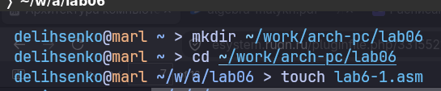


В `lab6-1.asm` введён текст программы из листинга 6.1: в `eax` и `ebx`
записываются символы «6» и «4», регистры складываются, результат из
`eax` сохраняется в буфер `buf1` и выводится подпрограммой `sprintLF`
(рис. <a href="#fig-3" class="quarto-xref">3</a>). Программа
оттранслирована и скомпонована командами `nasm -f elf lab6-1.asm` и
`ld -m elf_i386 -o lab6-1 lab6-1.o`.

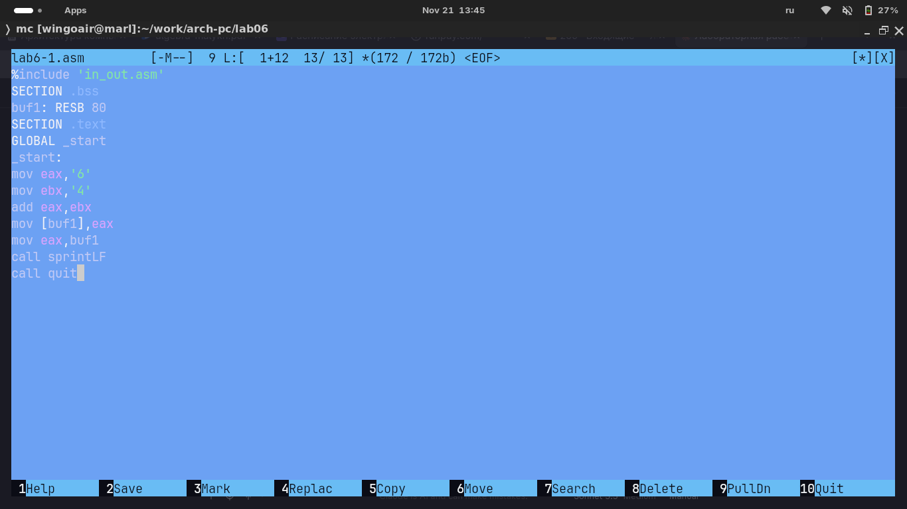

После запуска вместо числа 10 выведен символ `j` (рис.
<a href="#fig-4" class="quarto-xref">4</a>). Причина в том, что `add`
складывает не символы, а их ASCII-коды: 54 («6») + 52 («4») = 106, а код
106 соответствует символу `j`.

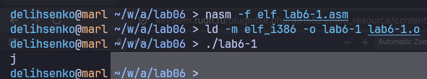

Затем строки `mov eax,'6'` и `mov ebx,'4'` заменены на `mov eax,6` и
`mov ebx,4` (рис. <a href="#fig-5" class="quarto-xref">5</a>), программа
пересобрана и запущена (рис.
<a href="#fig-6" class="quarto-xref">6</a>). Теперь складываются сами
числа, и в `eax` оказывается 10. Подпрограмма `sprintLF` воспринимает
значение как код символа, а код 10 по таблице ASCII — это символ
перевода строки (LF). Это управляющий символ, на экране он не
отображается: в терминале видна только пустая строка.

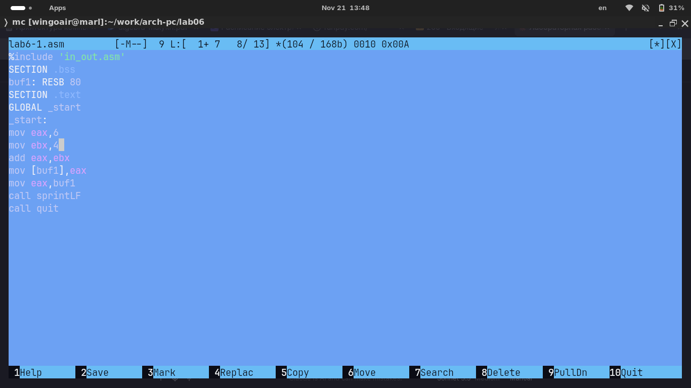

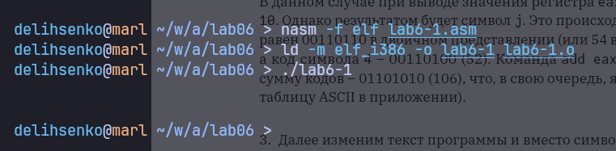

## Преобразование чисел функциями из in_out.asm

Создан файл `lab6-2.asm` (рис.
<a href="#fig-7" class="quarto-xref">7</a>), в него введён текст
листинга 6.2: тот же код, но вывод выполняется подпрограммой `iprintLF`
(рис. <a href="#fig-8" class="quarto-xref">8</a>).

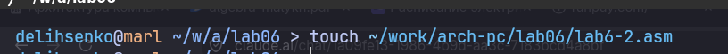

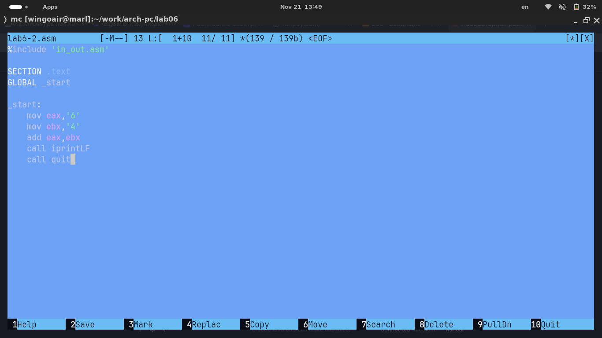

Программа выводит число 106 (рис.
<a href="#fig-9" class="quarto-xref">9</a>). Как и в первом случае,
`add` складывает коды символов (54 + 52 = 106), но `iprintLF` выводит
число, а не символ с таким кодом.

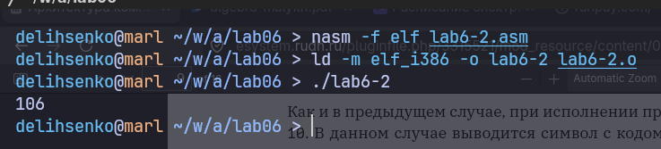

После замены символов на числа (`mov eax,6`, `mov ebx,4`, рис.
<a href="#fig-10" class="quarto-xref">10</a>) выводится результат
сложения 10 (рис. <a href="#fig-11" class="quarto-xref">11</a>).

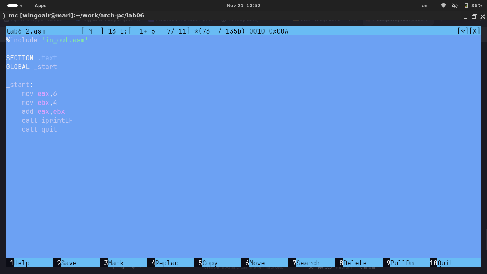

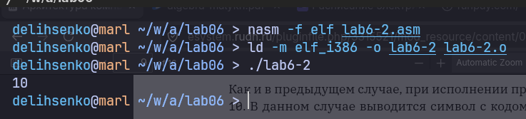

Подпрограмма `iprintLF` заменена на `iprint` (рис.
<a href="#fig-12" class="quarto-xref">12</a>). Программа вывела то же
число 10, но приглашение командной строки оказалось в той же строке, что
и результат (рис. <a href="#fig-13" class="quarto-xref">13</a>).

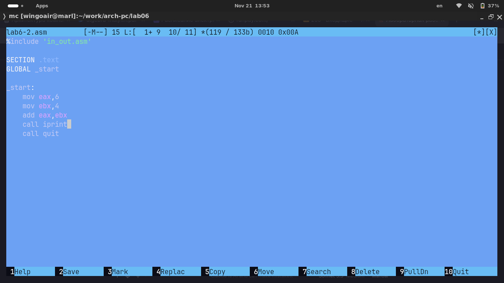

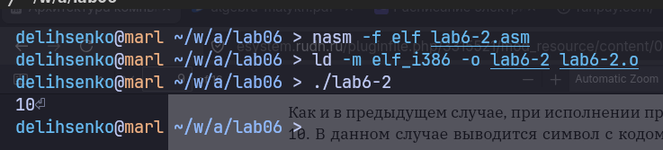

**Разница между `iprintLF` и `iprint`.** `iprintLF` после числа
добавляет символ перевода строки, а `iprint` — нет.

## Выполнение арифметических операций в NASM

Создан файл `lab6-3.asm` (рис.
<a href="#fig-14" class="quarto-xref">14</a>), в него введена программа
вычисления выражения *f*(*x*) = (5 ⋅ 2 + 3)/3 из листинга 6.3 (рис.
<a href="#fig-15" class="quarto-xref">15</a>). Умножение выполняется
`mul ebx`, затем прибавляется 3, регистр `edx` обнуляется, и `div ebx`
делит результат на 3. Частное из `eax` сохраняется в `edi`, остаток
остаётся в `edx`.

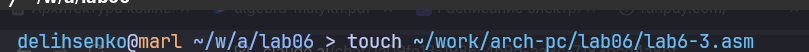

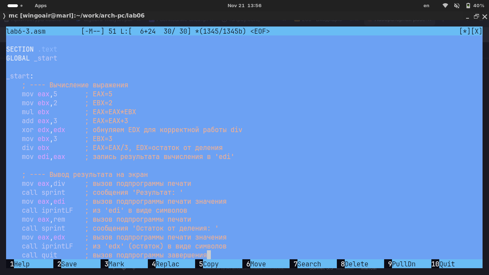

Программа вывела результат 4 и остаток 1 (рис.
<a href="#fig-16" class="quarto-xref">16</a>): (5 ⋅ 2 + 3)/3 = 13/3 = 4,
остаток 1.

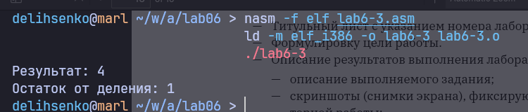

Затем программа изменена для вычисления выражения
*f*(*x*) = (4 ⋅ 6 + 2)/5 (рис.
<a href="#fig-17" class="quarto-xref">17</a>). Получены результат 5 и
остаток 1 (рис. <a href="#fig-18" class="quarto-xref">18</a>): 26/5 = 5,
остаток 1.

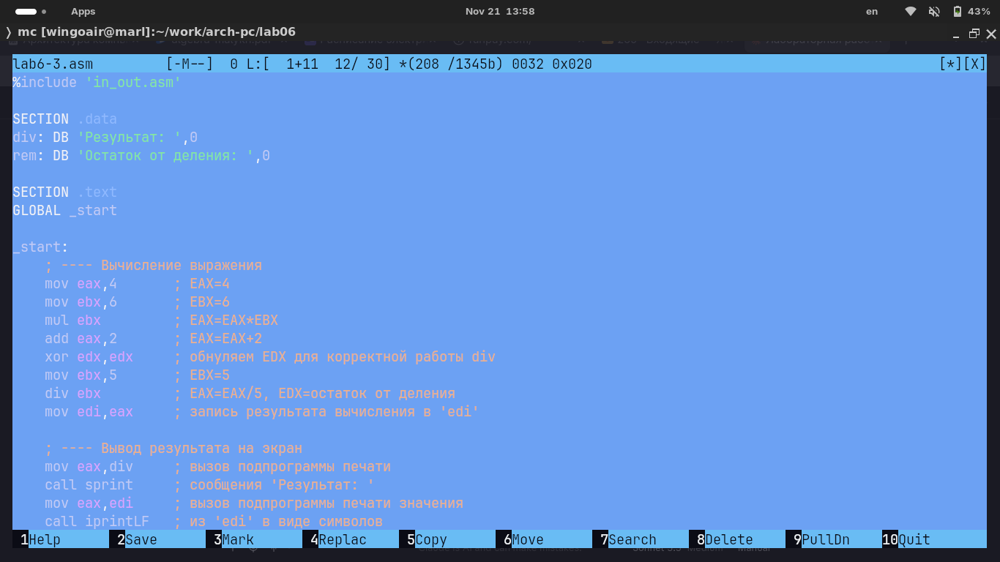

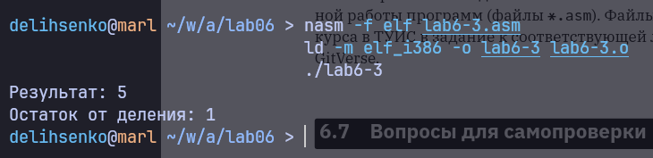

## Вычисление варианта задания

Создан файл `variant.asm` (рис.
<a href="#fig-19" class="quarto-xref">19</a>), в него введена программа
из листинга 6.4 (рис. <a href="#fig-20" class="quarto-xref">20</a>). Она
запрашивает номер студенческого билета, преобразует его в число
подпрограммой `atoi` и вычисляет вариант по формуле
(*S*<sub>*n*</sub> mod  20) + 1.


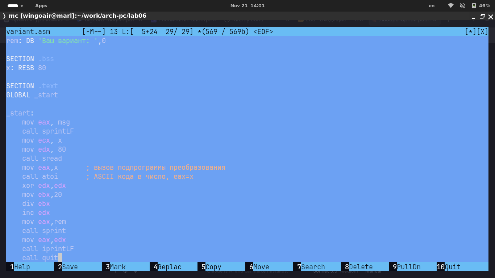

Для номера студенческого билета 1132260105 программа вывела вариант 6
(рис. <a href="#fig-21" class="quarto-xref">21</a>). Проверка вручную:
1132260105 mod  20 = 5, 5 + 1 = 6, результат совпадает.

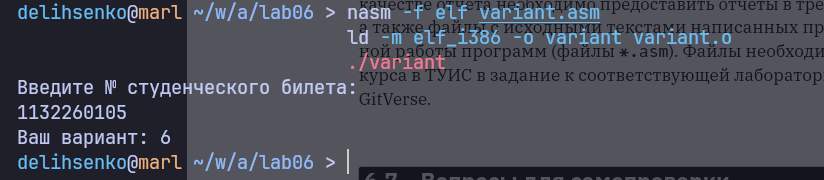

### Ответы на вопросы по листингу 6.4

1.  За вывод сообщения «Ваш вариант:» отвечают строки `mov eax,rem` и
    `call sprint`.
2.  `mov ecx, x` записывает в `ecx` адрес буфера `x`, `mov edx, 80`
    задаёт максимальную длину вводимой строки, `call sread` читает
    строку с клавиатуры и записывает её в буфер.
3.  `call atoi` преобразует строку из ASCII-символов (адрес в `eax`) в
    целое число, результат помещается в `eax`.
4.  За вычисление варианта отвечают строки `xor edx,edx`, `mov ebx,20`,
    `div ebx`, `inc edx`.
5.  Остаток от деления при выполнении `div ebx` записывается в регистр
    `edx`.
6.  `inc edx` увеличивает остаток на 1, чтобы получить вариант по
    формуле (*S*<sub>*n*</sub> mod  20) + 1 (номера вариантов начинаются
    с 1, а остаток лежит в диапазоне 0–19).
7.  За вывод результата отвечают строки `mov eax,edx` и `call iprintLF`.

# Выполнение самостоятельной работы

**Задание.** Написать программу вычисления выражения *y* = *f*(*x*).
Программа должна выводить выражение, запрашивать значение *x*, вычислять
выражение и выводить результат. Вид функции взять из табл. 6.3 в
соответствии с вариантом; проверить работу для *x*<sub>1</sub> и
*x*<sub>2</sub>. Выражение упрощать нельзя, при делении используется
только целая часть частного.

Для варианта 6: *f*(*x*) = *x*<sup>3</sup>/2 + 1, *x*<sub>1</sub> = 2,
*x*<sub>2</sub> = 5.

Создан файл `lab6-4.asm` (рис.
<a href="#fig-22" class="quarto-xref">22</a>) и написана программа (рис.
<a href="#fig-23" class="quarto-xref">23</a>). Значение *x* вводится
через `sread` и преобразуется `atoi`. Куб вычисляется двумя
последовательными `mul ebx` (после первого `eax`  = *x*<sup>2</sup>,
после второго *x*<sup>3</sup>), затем `xor edx,edx` и `div ecx` при
`ecx`  = 2 дают целую часть *x*<sup>3</sup>/2, после чего добавляется 1.


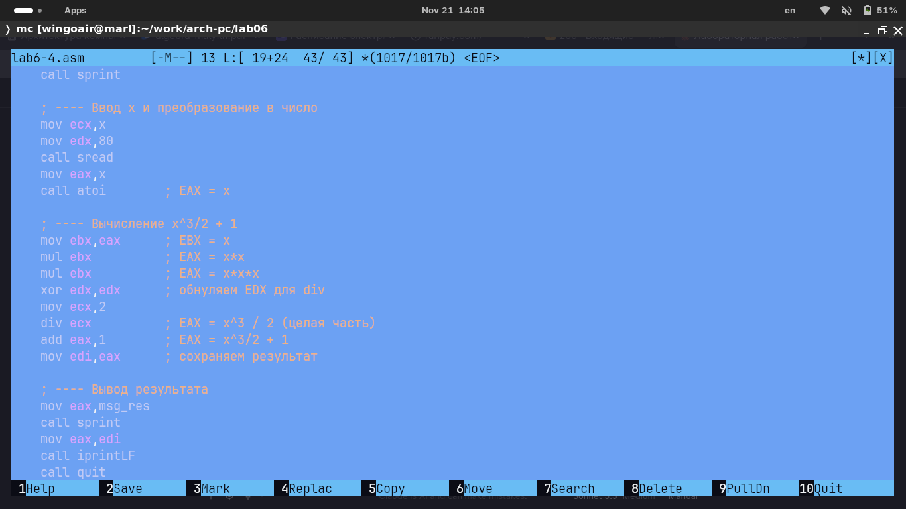

Программа собрана командами `nasm -f elf lab6-4.asm` и
`ld -m elf_i386 -o lab6-4 lab6-4.o` и проверена для двух значений *x*:

- при *x* = 2 получено 5 (рис.
  <a href="#fig-24" class="quarto-xref">24</a>):
  2<sup>3</sup>/2 + 1 = 8/2 + 1 = 5;
- при *x* = 5 получено 63 (рис.
  <a href="#fig-25" class="quarto-xref">25</a>):
  5<sup>3</sup>/2 + 1 = 125/2 + 1 = 62 + 1 = 63 (остаток от деления
  отбрасывается).

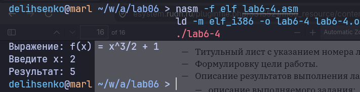

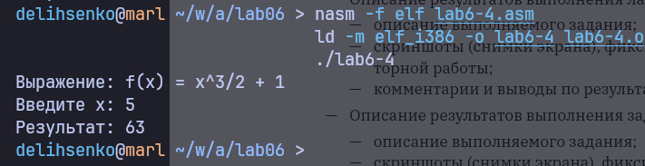

Результаты совпадают с ручным расчётом. Текст программы приведён в
приложении.

# Результаты

В каталоге `~/work/arch-pc/lab06` созданы и проверены пять программ.

<table>
<colgroup>
<col style="width: 31%" />
<col style="width: 37%" />
<col style="width: 31%" />
</colgroup>
<thead>
<tr>
<th>Программа</th>
<th>Особенности</th>
<th>Результат</th>
</tr>
</thead>
<tbody>
<tr>
<td><code>lab6-1</code></td>
<td>сложение символов и чисел, вывод <code>sprintLF</code></td>
<td><code>j</code> (сумма кодов 106); для чисел — символ LF (код
10)</td>
</tr>
<tr>
<td><code>lab6-2</code></td>
<td>вывод числа <code>iprintLF</code> / <code>iprint</code></td>
<td>106 для символов, 10 для чисел; <code>iprint</code> без перевода
строки</td>
</tr>
<tr>
<td><code>lab6-3</code></td>
<td><code>mul</code>, <code>div</code>, вывод частного и остатка</td>
<td><span class="math inline">(5 ⋅ 2 + 3)/3</span>: 4 и 1; <span
class="math inline">(4 ⋅ 6 + 2)/5</span>: 5 и 1</td>
</tr>
<tr>
<td><code>variant</code></td>
<td>ввод номера билета, <code>atoi</code>, <code>div</code>,
<code>inc</code></td>
<td>вариант 6</td>
</tr>
<tr>
<td><code>lab6-4</code></td>
<td>самостоятельная работа, <span
class="math inline"><em>f</em>(<em>x</em>) = <em>x</em><sup>3</sup>/2 + 1</span></td>
<td><span class="math inline"><em>f</em>(2) = 5</span>, <span
class="math inline"><em>f</em>(5) = 63</span></td>
</tr>
</tbody>
</table>

# Обсуждение результатов

Эксперименты с `lab6-1` и `lab6-2` показали, что процессор не различает
«символ» и «число»: в регистре лежит просто набор бит, а то, что будет
выведено, определяет подпрограмма вывода. `sprint`/`sprintLF` выводят
содержимое как строку (код 106 превращается в символ `j`, код 10 — в
невидимый перевод строки), а `iprint`/`iprintLF` преобразуют число в
строку из цифр.

Ввод с клавиатуры всегда приходит в виде ASCII-символов, поэтому перед
вычислениями его нужно преобразовать подпрограммой `atoi`, как в
`variant.asm` и `lab6-4.asm`. При делении `div` нужно помнить, что
делимое берётся из пары `edx:eax`, поэтому `edx` обнуляется заранее, а
после деления частное находится в `eax`, остаток — в `edx`.

# Заключение

- Изучены арифметические инструкции NASM: `add`, `mul`, `div`, `inc`, и
  их работа с регистрами `eax`, `ebx`, `edx`.
- Показана разница между сложением символов (суммируются ASCII-коды) и
  сложением чисел, а также между подпрограммами вывода `sprintLF` и
  `iprintLF`, `iprint` и `iprintLF`.
- Освоены подпрограммы `atoi`, `iprint`, `iprintLF` и ввод числа с
  клавиатуры.
- По номеру студенческого билета определён вариант 6; написана и
  проверена программа для *f*(*x*) = *x*<sup>3</sup>/2 + 1 (результаты 5
  при *x* = 2 и 63 при *x* = 5).

Цель работы достигнута.

# Листинги программ

## Листинг lab6-1.asm

``` nasm
%include 'in_out.asm'
SECTION .bss
buf1: RESB 80
SECTION .text
GLOBAL _start
_start:
mov eax,'6'
mov ebx,'4'
add eax,ebx
mov [buf1],eax
mov eax,buf1
call sprintLF
call quit
```

После замены символов на числа строки `mov eax,'6'` и `mov ebx,'4'`
приняли вид `mov eax,6` и `mov ebx,4`.

## Листинг lab6-2.asm

``` nasm
%include 'in_out.asm'

SECTION .text
GLOBAL _start

_start:
    mov eax,6
    mov ebx,4
    add eax,ebx
    call iprint
    call quit
```

В первом варианте использовались символы `'6'` и `'4'` и вызов
`iprintLF`.

## Листинг lab6-3.asm

``` nasm
%include 'in_out.asm'

SECTION .data
div: DB 'Результат: ',0
rem: DB 'Остаток от деления: ',0

SECTION .text
GLOBAL _start

_start:
    ; ---- Вычисление выражения
    mov eax,4       ; EAX=4
    mov ebx,6       ; EBX=6
    mul ebx         ; EAX=EAX*EBX
    add eax,2       ; EAX=EAX+2
    xor edx,edx     ; обнуляем EDX для корректной работы div
    mov ebx,5       ; EBX=5
    div ebx         ; EAX=EAX/5, EDX=остаток от деления
    mov edi,eax     ; запись результата вычисления в 'edi'

    ; ---- Вывод результата на экран
    mov eax,div     ; вызов подпрограммы печати
    call sprint     ; сообщения 'Результат: '
    mov eax,edi     ; вызов подпрограммы печати значения
    call iprintLF   ; из 'edi' в виде символов
    mov eax,rem     ; вызов подпрограммы печати
    call sprint     ; сообщения 'Остаток от деления: '
    mov eax,edx     ; вызов подпрограммы печати значения
    call iprintLF   ; из 'edx' (остаток) в виде символов
    call quit       ; вызов подпрограммы завершения
```

В первом варианте вычислялось (5 ⋅ 2 + 3)/3: `mov eax,5`, `mov ebx,2`,
`add eax,3`, `mov ebx,3`.

## Листинг variant.asm

``` nasm
%include 'in_out.asm'

SECTION .data
msg: DB 'Введите № студенческого билета: ',0
rem: DB 'Ваш вариант: ',0

SECTION .bss
x: RESB 80

SECTION .text
GLOBAL _start

_start:
    mov eax, msg
    call sprintLF
    mov ecx, x
    mov edx, 80
    call sread
    mov eax,x       ; вызов подпрограммы преобразования
    call atoi       ; ASCII кода в число, eax=x
    xor edx,edx
    mov ebx,20
    div ebx
    inc edx
    mov eax,rem
    call sprint
    mov eax,edx
    call iprintLF
    call quit
```

## Листинг lab6-4.asm

``` nasm
%include 'in_out.asm'

SECTION .data
msg_expr: DB 'Выражение: f(x) = x^3/2 + 1',0
msg_x:    DB 'Введите x: ',0
msg_res:  DB 'Результат: ',0

SECTION .bss
x: RESB 80

SECTION .text
GLOBAL _start

_start:
    ; ---- Вывод выражения и запрос x
    mov eax,msg_expr
    call sprintLF
    mov eax,msg_x
    call sprint

    ; ---- Ввод x и преобразование в число
    mov ecx,x
    mov edx,80
    call sread
    mov eax,x
    call atoi        ; EAX = x

    ; ---- Вычисление x^3/2 + 1
    mov ebx,eax      ; EBX = x
    mul ebx          ; EAX = x*x
    mul ebx          ; EAX = x*x*x
    xor edx,edx      ; обнуляем EDX для div
    mov ecx,2
    div ecx          ; EAX = x^3 / 2 (целая часть)
    add eax,1        ; EAX = x^3/2 + 1
    mov edi,eax      ; сохраняем результат

    ; ---- Вывод результата
    mov eax,msg_res
    call sprint
    mov eax,edi
    call iprintLF
    call quit
```
