---
## Author
author:
  name: Лысенко Даниил Эдуардович
  affiliation:
    - name: Российский университет дружбы народов
      country: Российская Федерация
      postal-code: 117198
      city: Москва
      address: ул. Миклухо-Маклая, д. 6

## Title
title: "Отчёт по лабораторной работе №6"
subtitle: "Арифметические операции в NASM"
license: "CC BY"
abstract: |
  В отчёте представлены результаты выполнения лабораторной работы №6: освоены арифметические инструкции языка ассемблера NASM (`add`, `mul`, `div`, `inc`), изучена разница между символьным и числовым представлением данных и работа подпрограмм преобразования `atoi`, `iprint`, `iprintLF` из файла in_out.asm.

  Написаны и запущены программы сложения, вычисления выражения, определения варианта задания по номеру студенческого билета и программа для самостоятельной работы (вариант 6).
keywords: [NASM, ассемблер, add, mul, div, ASCII, atoi, iprintLF]
---

# Введение

## Цель работы

Освоение арифметических инструкций языка ассемблера NASM.

## Задачи

- изучить, как в регистры и память записываются символьные и числовые данные и чем различается результат сложения символов и чисел;
- освоить подпрограммы `iprint`, `iprintLF` (вывод числа) и `atoi` (преобразование строки в число) из файла `in_out.asm`;
- выполнить арифметические операции `add`, `mul`, `div` и вычислить выражение с выводом результата и остатка от деления;
- определить свой вариант задания по номеру студенческого билета;
- написать программу вычисления функции $f(x)$ в соответствии с вариантом.

# Теоретическая часть

## Арифметические инструкции

Сложение выполняется инструкцией `add dst, src`, увеличение на единицу --- `inc dst`. Умножение беззнаковых чисел выполняет `mul src`: второй множитель находится в `eax`, и результат помещается в `eax` (для 32-битных операндов старшая часть результата записывается в `edx`). Деление беззнаковых чисел выполняет `div src`: делимое находится в паре `edx:eax`, неполное частное записывается в `eax`, остаток --- в `edx`. Перед `div` регистр `edx` необходимо обнулить (`xor edx, edx`), иначе деление будет некорректным.

## Символьный и числовой ввод/вывод

Ввод с клавиатуры и вывод на экран выполняются в символьном виде в кодировке ASCII, каждый символ занимает один байт. Код символа «6» равен 54, код символа «4» --- 52. Для работы с числами в `in_out.asm` реализованы подпрограммы: `iprint` и `iprintLF` печатают число из `eax` в виде строки (вторая добавляет перевод строки), `atoi` преобразует строку из ASCII-символов, адрес которой записан в `eax`, в число.

# Материалы и методы

Работа выполнялась в терминале ОС Linux. Использованы файловый менеджер Midnight Commander и его встроенный редактор `mcedit`, ассемблер NASM, компоновщик `ld` (режим `elf_i386`) и файл подпрограмм `in_out.asm`. Все файлы лабораторной работы находятся в каталоге `~/work/arch-pc/lab06`.

# Выполнение лабораторной работы

## Символьные и численные данные в NASM

Создан каталог `lab06`, выполнен переход в него и создан файл `lab6-1.asm` (рис. -@fig-1). Файл `in_out.asm` скопирован из каталога `lab05` в `lab06`, чтобы директива `%include` могла его найти (рис. -@fig-2).

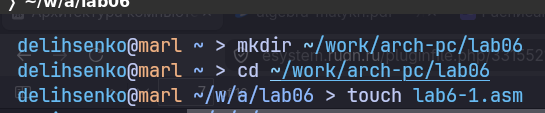{#fig-1}

{#fig-2}

В `lab6-1.asm` введён текст программы из листинга 6.1: в `eax` и `ebx` записываются символы «6» и «4», регистры складываются, результат из `eax` сохраняется в буфер `buf1` и выводится подпрограммой `sprintLF` (рис. -@fig-3). Программа оттранслирована и скомпонована командами `nasm -f elf lab6-1.asm` и `ld -m elf_i386 -o lab6-1 lab6-1.o`.

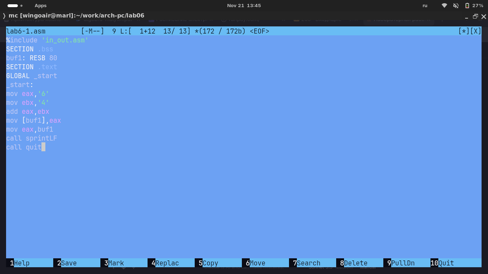{#fig-3 width=100%}

После запуска вместо числа 10 выведен символ `j` (рис. -@fig-4). Причина в том, что `add` складывает не символы, а их ASCII-коды: 54 («6») + 52 («4») = 106, а код 106 соответствует символу `j`.

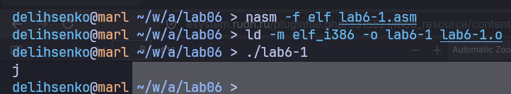{#fig-4}

Затем строки `mov eax,'6'` и `mov ebx,'4'` заменены на `mov eax,6` и `mov ebx,4` (рис. -@fig-5), программа пересобрана и запущена (рис. -@fig-6). Теперь складываются сами числа, и в `eax` оказывается 10. Подпрограмма `sprintLF` воспринимает значение как код символа, а код 10 по таблице ASCII --- это символ перевода строки (LF). Это управляющий символ, на экране он не отображается: в терминале видна только пустая строка.

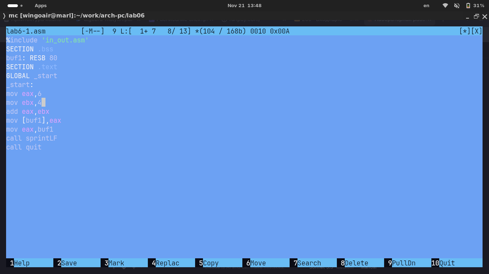{#fig-5 width=100%}

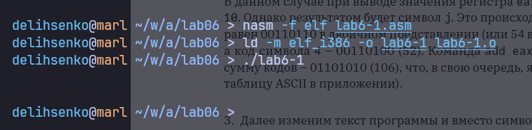{#fig-6}

## Преобразование чисел функциями из in_out.asm

Создан файл `lab6-2.asm` (рис. -@fig-7), в него введён текст листинга 6.2: тот же код, но вывод выполняется подпрограммой `iprintLF` (рис. -@fig-8).

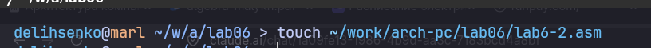{#fig-7}

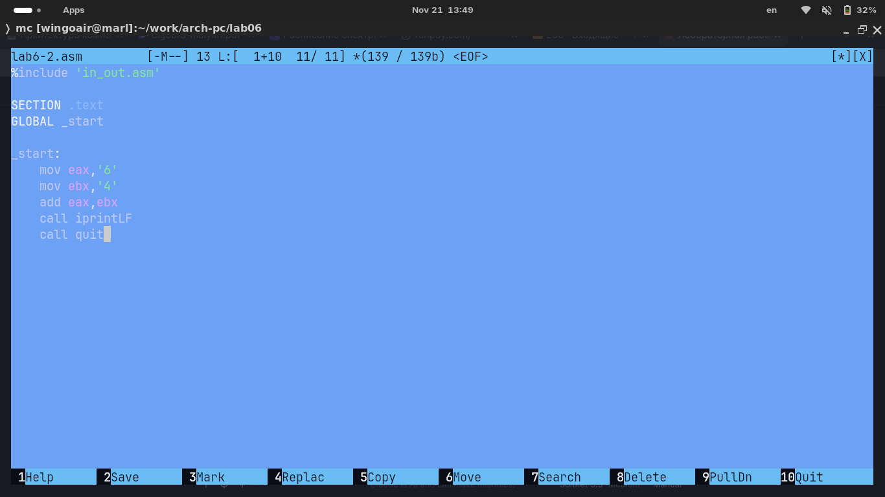{#fig-8 width=100%}

Программа выводит число 106 (рис. -@fig-9). Как и в первом случае, `add` складывает коды символов (54 + 52 = 106), но `iprintLF` выводит число, а не символ с таким кодом.

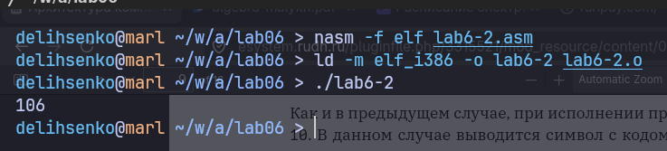{#fig-9}

После замены символов на числа (`mov eax,6`, `mov ebx,4`, рис. -@fig-10) выводится результат сложения 10 (рис. -@fig-11).

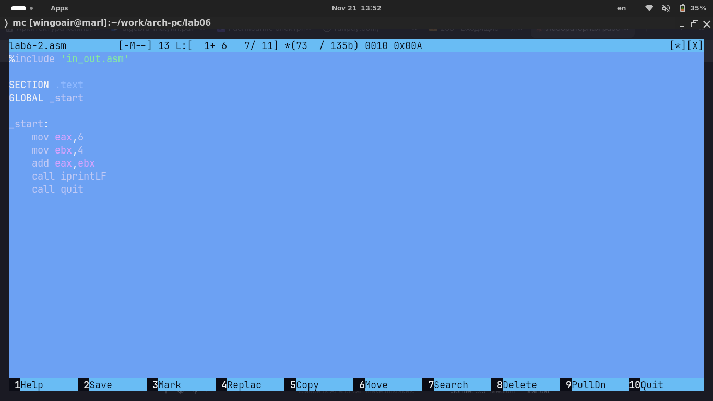{#fig-10 width=100%}

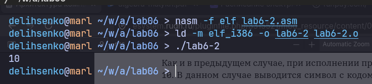{#fig-11}

Подпрограмма `iprintLF` заменена на `iprint` (рис. -@fig-12). Программа вывела то же число 10, но приглашение командной строки оказалось в той же строке, что и результат (рис. -@fig-13).

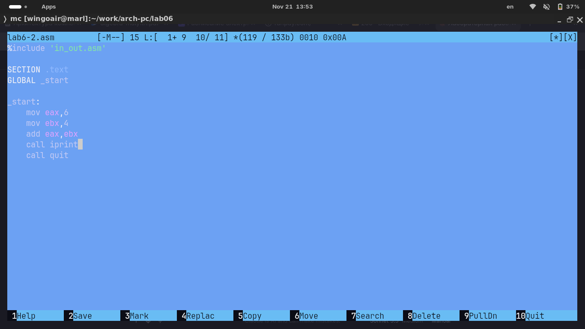{#fig-12 width=100%}

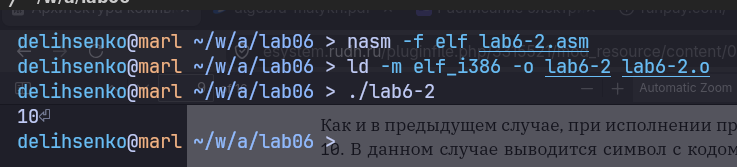{#fig-13}

**Разница между `iprintLF` и `iprint`.** `iprintLF` после числа добавляет символ перевода строки, а `iprint` --- нет.

## Выполнение арифметических операций в NASM

Создан файл `lab6-3.asm` (рис. -@fig-14), в него введена программа вычисления выражения $f(x) = (5 \cdot 2 + 3)/3$ из листинга 6.3 (рис. -@fig-15). Умножение выполняется `mul ebx`, затем прибавляется 3, регистр `edx` обнуляется, и `div ebx` делит результат на 3. Частное из `eax` сохраняется в `edi`, остаток остаётся в `edx`.

{#fig-14}

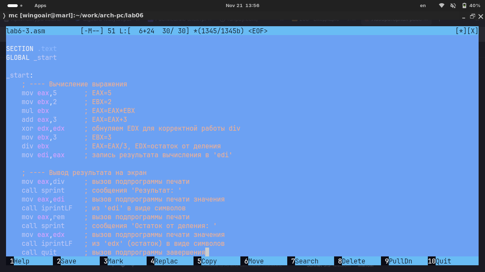{#fig-15 width=100%}

Программа вывела результат 4 и остаток 1 (рис. -@fig-16): $(5 \cdot 2 + 3)/3 = 13/3 = 4$, остаток 1.

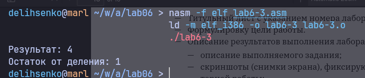{#fig-16}

Затем программа изменена для вычисления выражения $f(x) = (4 \cdot 6 + 2)/5$ (рис. -@fig-17). Получены результат 5 и остаток 1 (рис. -@fig-18): $26/5 = 5$, остаток 1.

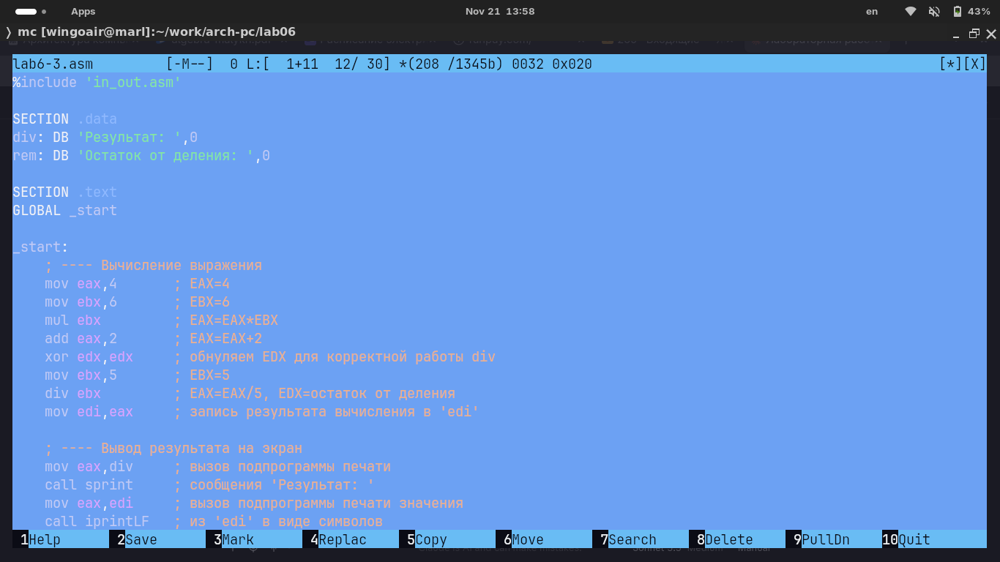{#fig-17 width=100%}

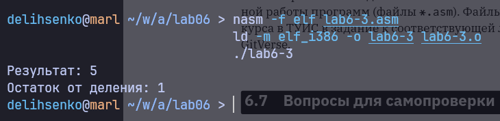{#fig-18}

## Вычисление варианта задания

Создан файл `variant.asm` (рис. -@fig-19), в него введена программа из листинга 6.4 (рис. -@fig-20). Она запрашивает номер студенческого билета, преобразует его в число подпрограммой `atoi` и вычисляет вариант по формуле $(S_n \bmod 20) + 1$.

{#fig-19}

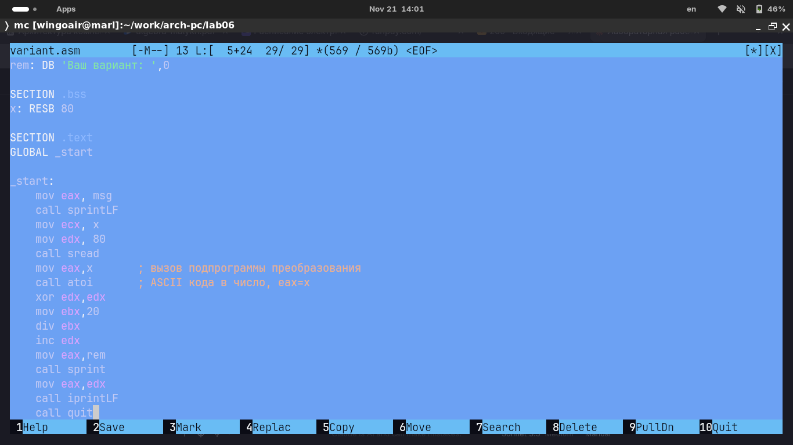{#fig-20 width=100%}

Для номера студенческого билета 1132260105 программа вывела вариант 6 (рис. -@fig-21). Проверка вручную: $1132260105 \bmod 20 = 5$, $5 + 1 = 6$, результат совпадает.

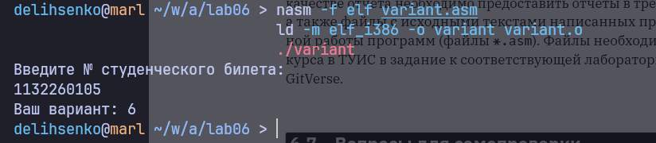{#fig-21}

### Ответы на вопросы по листингу 6.4

1. За вывод сообщения «Ваш вариант:» отвечают строки `mov eax,rem` и `call sprint`.
2. `mov ecx, x` записывает в `ecx` адрес буфера `x`, `mov edx, 80` задаёт максимальную длину вводимой строки, `call sread` читает строку с клавиатуры и записывает её в буфер.
3. `call atoi` преобразует строку из ASCII-символов (адрес в `eax`) в целое число, результат помещается в `eax`.
4. За вычисление варианта отвечают строки `xor edx,edx`, `mov ebx,20`, `div ebx`, `inc edx`.
5. Остаток от деления при выполнении `div ebx` записывается в регистр `edx`.
6. `inc edx` увеличивает остаток на 1, чтобы получить вариант по формуле $(S_n \bmod 20) + 1$ (номера вариантов начинаются с 1, а остаток лежит в диапазоне 0--19).
7. За вывод результата отвечают строки `mov eax,edx` и `call iprintLF`.

# Выполнение самостоятельной работы

**Задание.** Написать программу вычисления выражения $y = f(x)$. Программа должна выводить выражение, запрашивать значение $x$, вычислять выражение и выводить результат. Вид функции взять из табл. 6.3 в соответствии с вариантом; проверить работу для $x_1$ и $x_2$. Выражение упрощать нельзя, при делении используется только целая часть частного.

Для варианта 6: $f(x) = x^3/2 + 1$, $x_1 = 2$, $x_2 = 5$.

Создан файл `lab6-4.asm` (рис. -@fig-22) и написана программа (рис. -@fig-23). Значение $x$ вводится через `sread` и преобразуется `atoi`. Куб вычисляется двумя последовательными `mul ebx` (после первого `eax` $= x^2$, после второго $x^3$), затем `xor edx,edx` и `div ecx` при `ecx` $= 2$ дают целую часть $x^3/2$, после чего добавляется 1.

{#fig-22}

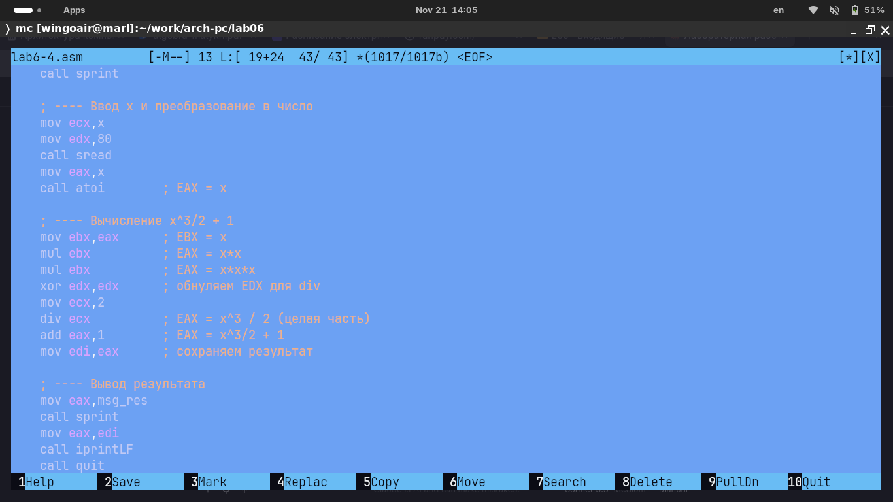{#fig-23 width=100%}

Программа собрана командами `nasm -f elf lab6-4.asm` и `ld -m elf_i386 -o lab6-4 lab6-4.o` и проверена для двух значений $x$:

- при $x = 2$ получено 5 (рис. -@fig-24): $2^3/2 + 1 = 8/2 + 1 = 5$;
- при $x = 5$ получено 63 (рис. -@fig-25): $5^3/2 + 1 = 125/2 + 1 = 62 + 1 = 63$ (остаток от деления отбрасывается).

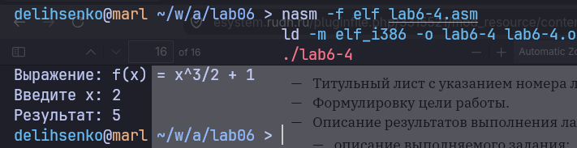{#fig-24}

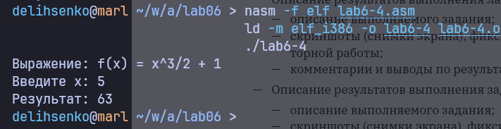{#fig-25}

Результаты совпадают с ручным расчётом. Текст программы приведён в приложении.

# Результаты

В каталоге `~/work/arch-pc/lab06` созданы и проверены пять программ.

| Программа | Особенности | Результат |
|-----------|-------------|-----------|
| `lab6-1`  | сложение символов и чисел, вывод `sprintLF` | `j` (сумма кодов 106); для чисел --- символ LF (код 10) |
| `lab6-2`  | вывод числа `iprintLF` / `iprint` | 106 для символов, 10 для чисел; `iprint` без перевода строки |
| `lab6-3`  | `mul`, `div`, вывод частного и остатка | $(5 \cdot 2+3)/3$: 4 и 1; $(4 \cdot 6+2)/5$: 5 и 1 |
| `variant` | ввод номера билета, `atoi`, `div`, `inc` | вариант 6 |
| `lab6-4`  | самостоятельная работа, $f(x)=x^3/2+1$ | $f(2)=5$, $f(5)=63$ |

# Обсуждение результатов

Эксперименты с `lab6-1` и `lab6-2` показали, что процессор не различает «символ» и «число»: в регистре лежит просто набор бит, а то, что будет выведено, определяет подпрограмма вывода. `sprint`/`sprintLF` выводят содержимое как строку (код 106 превращается в символ `j`, код 10 --- в невидимый перевод строки), а `iprint`/`iprintLF` преобразуют число в строку из цифр.

Ввод с клавиатуры всегда приходит в виде ASCII-символов, поэтому перед вычислениями его нужно преобразовать подпрограммой `atoi`, как в `variant.asm` и `lab6-4.asm`. При делении `div` нужно помнить, что делимое берётся из пары `edx:eax`, поэтому `edx` обнуляется заранее, а после деления частное находится в `eax`, остаток --- в `edx`.

# Заключение

- Изучены арифметические инструкции NASM: `add`, `mul`, `div`, `inc`, и их работа с регистрами `eax`, `ebx`, `edx`.
- Показана разница между сложением символов (суммируются ASCII-коды) и сложением чисел, а также между подпрограммами вывода `sprintLF` и `iprintLF`, `iprint` и `iprintLF`.
- Освоены подпрограммы `atoi`, `iprint`, `iprintLF` и ввод числа с клавиатуры.
- По номеру студенческого билета определён вариант 6; написана и проверена программа для $f(x) = x^3/2 + 1$ (результаты 5 при $x=2$ и 63 при $x=5$).

Цель работы достигнута.

\appendix

# Листинги программ {.appendix}

## Листинг lab6-1.asm

```nasm
%include 'in_out.asm'
SECTION .bss
buf1: RESB 80
SECTION .text
GLOBAL _start
_start:
mov eax,'6'
mov ebx,'4'
add eax,ebx
mov [buf1],eax
mov eax,buf1
call sprintLF
call quit
```

После замены символов на числа строки `mov eax,'6'` и `mov ebx,'4'` приняли вид `mov eax,6` и `mov ebx,4`.

## Листинг lab6-2.asm

```nasm
%include 'in_out.asm'

SECTION .text
GLOBAL _start

_start:
    mov eax,6
    mov ebx,4
    add eax,ebx
    call iprint
    call quit
```

В первом варианте использовались символы `'6'` и `'4'` и вызов `iprintLF`.

## Листинг lab6-3.asm

```nasm
%include 'in_out.asm'

SECTION .data
div: DB 'Результат: ',0
rem: DB 'Остаток от деления: ',0

SECTION .text
GLOBAL _start

_start:
    ; ---- Вычисление выражения
    mov eax,4       ; EAX=4
    mov ebx,6       ; EBX=6
    mul ebx         ; EAX=EAX*EBX
    add eax,2       ; EAX=EAX+2
    xor edx,edx     ; обнуляем EDX для корректной работы div
    mov ebx,5       ; EBX=5
    div ebx         ; EAX=EAX/5, EDX=остаток от деления
    mov edi,eax     ; запись результата вычисления в 'edi'

    ; ---- Вывод результата на экран
    mov eax,div     ; вызов подпрограммы печати
    call sprint     ; сообщения 'Результат: '
    mov eax,edi     ; вызов подпрограммы печати значения
    call iprintLF   ; из 'edi' в виде символов
    mov eax,rem     ; вызов подпрограммы печати
    call sprint     ; сообщения 'Остаток от деления: '
    mov eax,edx     ; вызов подпрограммы печати значения
    call iprintLF   ; из 'edx' (остаток) в виде символов
    call quit       ; вызов подпрограммы завершения
```

В первом варианте вычислялось $(5 \cdot 2 + 3)/3$: `mov eax,5`, `mov ebx,2`, `add eax,3`, `mov ebx,3`.

## Листинг variant.asm

```nasm
%include 'in_out.asm'

SECTION .data
msg: DB 'Введите № студенческого билета: ',0
rem: DB 'Ваш вариант: ',0

SECTION .bss
x: RESB 80

SECTION .text
GLOBAL _start

_start:
    mov eax, msg
    call sprintLF
    mov ecx, x
    mov edx, 80
    call sread
    mov eax,x       ; вызов подпрограммы преобразования
    call atoi       ; ASCII кода в число, eax=x
    xor edx,edx
    mov ebx,20
    div ebx
    inc edx
    mov eax,rem
    call sprint
    mov eax,edx
    call iprintLF
    call quit
```

## Листинг lab6-4.asm

```nasm
%include 'in_out.asm'

SECTION .data
msg_expr: DB 'Выражение: f(x) = x^3/2 + 1',0
msg_x:    DB 'Введите x: ',0
msg_res:  DB 'Результат: ',0

SECTION .bss
x: RESB 80

SECTION .text
GLOBAL _start

_start:
    ; ---- Вывод выражения и запрос x
    mov eax,msg_expr
    call sprintLF
    mov eax,msg_x
    call sprint

    ; ---- Ввод x и преобразование в число
    mov ecx,x
    mov edx,80
    call sread
    mov eax,x
    call atoi        ; EAX = x

    ; ---- Вычисление x^3/2 + 1
    mov ebx,eax      ; EBX = x
    mul ebx          ; EAX = x*x
    mul ebx          ; EAX = x*x*x
    xor edx,edx      ; обнуляем EDX для div
    mov ecx,2
    div ecx          ; EAX = x^3 / 2 (целая часть)
    add eax,1        ; EAX = x^3/2 + 1
    mov edi,eax      ; сохраняем результат

    ; ---- Вывод результата
    mov eax,msg_res
    call sprint
    mov eax,edi
    call iprintLF
    call quit
```
